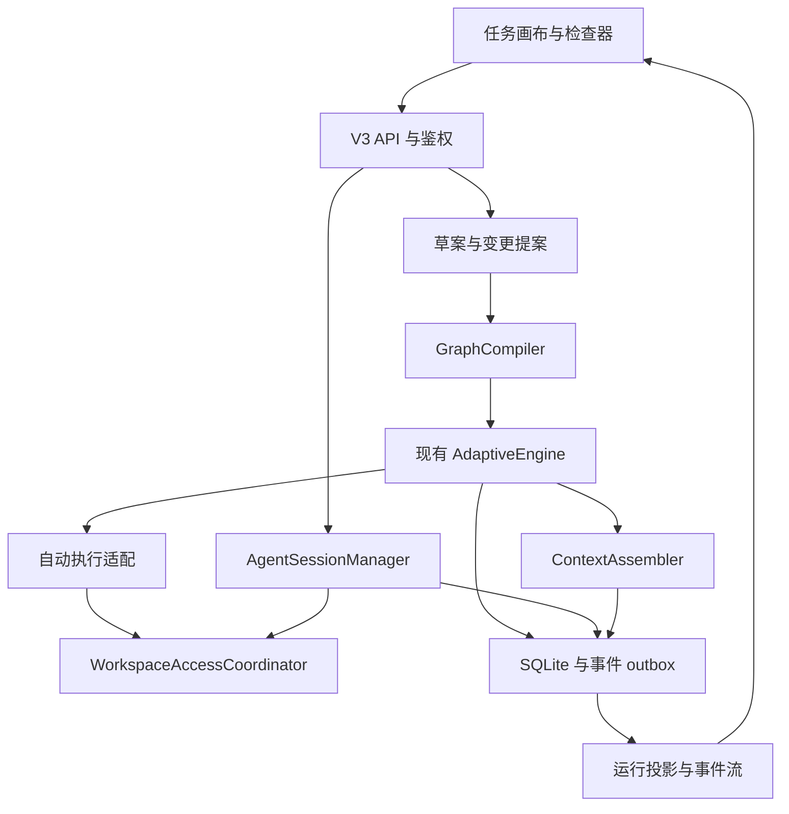

# AI Work OS Canvas V3.1 开发架构设计

> 状态：开发设计基线，尚未实现；不得将本文目标能力视为已交付功能。
> 日期：2026-11-15（北京时间）
> 源码核对基线：main / 2ba8fcb7c0023cdcf793f5e290c8150615fe6b45。
> 适用环境：个人开发者、Linux 单机、React/TypeScript、Node.js 22.13+、SQLite。
> 本文细化并调整 [Canvas V3 完整方案](AI-Work-OS-Canvas-V3-完整方案.md)。产品方向沿用 V3；发生冲突时，V3.1 的对象边界、知识冻结、人工接管和实施顺序为下一阶段开发依据。当前行为仍以代码及 V2 实现说明为准。

## 1. 目标、范围与架构决策

目标是让用户在同一画布完成任务规划、能力创建、知识配置、运行观察、CLI 协作、变更接纳、交付验收和经验沉淀。用户无需编辑 JSON，即可完成常规路径；高级用户仍可检查真实契约和执行证据。

首版范围：一个项目、一个任务、一个共享 Git Worktree；受限 DAG；Codex/OpenCode 自动执行；能力构建助手；节点知识契约；运行及差异画布；安全暂停后的交互会话。既有 V1/V2 入口继续可用。

暂不包含：分布式 Worker、多用户同时写入、无限循环、任意 Shell 入口、任意 JavaScript 表达式、自动发布所有生成能力、供应商内部会话无损恢复、多仓库原子事务。独立 Worktree 并行写及显式合并列为后续扩展。

关键决策：

1. 任务目标是默认入口；画布是任务工作台，资源库按需展开。
2. 统一展示不等于统一存储：布局、草案、编译计划、执行事实分别建模。
3. PlanDraft 允许缺口；CompiledPlan 不允许未解析能力、必需知识或输入。
4. 复用 AdaptiveEngine，新增编译和投影层，不创建第二套调度器。
5. 能力定义、图节点、执行调用、人工会话具有不同身份。
6. 运行知识固定版本；显式接纳新知识后产生新计划版本。
7. 已发生动作不可抹除；结果可以失效，动作不能因此隐式重放。
8. 首版写入 CLI 采用整次运行暂停后接管，所有访问经过统一工作区协调器。
9. AI 生成提案，后端执行确定性校验、授权和状态转换。
10. 真实供应商权限、Linux 进程停止和终端恢复必须另行验收。

## 2. 源码现状与复用边界

| 位置 | 当前事实 | V3.1 改造 |
|---|---|---|
| apps/web/src/AdaptiveBoard.tsx | 表单、JSON 计划、节点与事件列表；轮询运行状态 | 拆为画布页面、检查器、客户端与资源面板 |
| apps/web/src/CapabilityBuilderBoard.tsx | 自然语言构建、材料、候选修订、样例验证 | 嵌入节点缺口及能力开发抽屉 |
| packages/adaptive/engine.ts | PlanInput、依赖、绑定、条件、观察点、运行状态、重规划 | 增加编译计划入口、效果历史、结果有效性与预览提交 |
| packages/adaptive/assets.ts | 能力/Profile/知识版本、发布和检索 | 节点级知识要求与证据治理 |
| packages/adaptive/runtime.ts | Agent 执行、祖先结果上下文、任务 Worktree、知识提取 | 接入 ContextAssembler 和统一访问协调器 |
| packages/persistence/index.ts | entities/events/idempotency/outbox；同步事务；user_version=1 | 增量迁移、索引、CAS、会话和效果记录 |
| apps/server/app.ts | HTTP、鉴权、V1/V2 路由 | 按功能拆分路由并增加 V3 接口 |

核对结论：

- V2 已支持独立就绪分支并行：当前非工作区写入批次最多 4 个，工作区写入单独执行；不能将 V1 串行描述套用于 V2。
- executeNode 在调用时记录知识 ID/摘要，replan 会比较知识命中，已有粗粒度知识变化检测。
- runtime 注入祖先节点结果；尚不是节点契约驱动的最小上下文。
- 已有运行后知识草稿提取，不应重复建设同名独立服务。
- replan 对成功 workspace-write 有保留检查；同一检查未覆盖成功 external-write，应优先补齐。
- Builder 被明确禁止作为普通 DAG 节点，继续通过受控构建 API 调用。
- 当前 adoptWorkspace 有通用输出形状假设；V3.1 人工接纳必须适配自定义输出契约。
- 数据库事务禁止 Promise；任何模型、PTY、文件扫描或外部请求均放在事务外。

上述为源码审阅，不代表本次已运行测试或验证真实供应商。

## 3. 用户界面与交互规则

### 3.1 任务入口

首页默认展示目标输入、项目选择、补充材料、验收条件及“生成方案”。Agent、预算、知识范围和 cwd 使用可见的项目默认值，高级设置按需展开。项目未配置时先进行集中环境配置。

同时提供“创建原子能力”，允许脱离任务创建可复用资源。能力创建不要求先构造完整工作流。

| 区域 | 默认内容 | 展开内容 |
|---|---|---|
| 顶部 | 目标、当前状态、主要操作 | 版本、约束、预算、验收 |
| 左侧 | 收起的资源抽屉 | 能力、知识、Skill、模板 |
| 中间 | 能力节点、依赖和异常 | 数据/知识层、观察点、差异 |
| 右侧 | 选中对象的检查器 | 输入、知识、Agent、输出、历史 |
| 底部 | AI 指令栏 | 对话、终端、事件时间线 |

设计、运行、回溯共用画布组件。运行态不可直接改已冻结计划，编辑操作产生变更提案。回溯默认只读。

### 3.2 主要操作

| 状态 | 主操作 | 次要操作 |
|---|---|---|
| 无方案 | 生成方案 | 创建能力、导入模板 |
| 草案有缺口 | 补齐缺口 | 保存、AI 修改 |
| 编译通过 | 开始执行 | 查看准备结果 |
| 运行中 | 暂停 | 日志、定位当前节点 |
| 等待材料 | 补充材料 | 查看阻断原因 |
| 失败 | 查看处理建议 | 受控重试、修改方案 |
| 已安全暂停 | 进入 CLI | 修改草案、继续 |
| CLI 已退出 | 核对变更 | 保留现场 |
| 待验收 | 查看交付 | 接受或退回 |

主按钮由后端 allowedActions 投影生成，前端不自行推断权限；服务端再次检查。

### 3.3 节点展示与编辑

默认卡片显示标题、状态、Agent/Runner、cwd 简写、知识/输出数量；悬停不展示大量日志。选中后显示输入输出端口及相关边，检查器提供“概览、输入与知识、执行与 CLI、输出与证据、历史”。

明确区分：
- 修改本任务配置：只修改 NodeSpec。
- 开发能力新版本：创建 Capability candidate 和独立开发会话。
- 进入本次执行 CLI：操作本 Run 的工作区。

节点具有稳定 UUID 身份，展示名称可改；适配当前引擎的短 node key 单独保存。复制节点创建新身份，不复制 Invocation 或外部动作授权。

拖动、缩放、阶段折叠只保存布局。撤销/重做仅作用于草案编辑和布局，不撤销真实运行、发布或外部动作。

### 3.4 连线、布局与移动端

数据绑定是语义事实，数据边由绑定推导；显式 dependsOn 表达无数据传递的顺序约束。复合边可展开显示各条关系。删除一项绑定只删除该项；其他关系仍存在时保留边。

输出连接到输入后推荐兼容字段；唯一匹配可填入草案并显示摘要，有歧义时选择，不兼容时建议显式转换节点。高级 JSON 编辑走相同编译器。

重规划保持未变节点位置；新增节点局部布局。首版保留当前 30 节点、20 观察点等引擎限制，界面明确提示，不借前端组件绕过限制。移动端以节点列表、检查器和运行观察为主，不承诺桌面同等复杂拖拽；提供键盘添加、连接、定位，状态同时使用文字和图标。

## 4. 系统分层



控制服务是数据库唯一写入者；Worker/PTY 管理组件通过控制协议返回事件。业务事件及状态更新同一事务提交，异步执行意图写入 outbox，再由监督器派发。

模块职责：
- GraphDraftService：草案、缺口、编辑操作、版本冲突。
- GraphCompiler：纯规则校验与授权解析；可复用 V2 validate。
- GraphProjectionService：计划、执行状态、资源摘要到 UI 投影。
- ContextAssembler：解析输入、知识、工件和预算，保存调用清单。
- ImpactAnalyzer：计算结果失效、下游影响和保留理由。
- PlanChangeService：提案预览、审批摘要、CAS 提交。
- AgentSessionManager：PTY 启动、认证连接、回放、停止与核对。
- WorkspaceAccessCoordinator：自动/人工访问、租约、fencing epoch。
- KnowledgeCurationService：候选提炼、证据校验、冲突与发布。
- CapabilityDevelopmentService：能力新版本开发和 Builder 集成。

## 5. 核心数据模型

以下为目标契约示意；具体 Zod 定义、JSON Schema 和 OpenAPI 应在实现 PR 中同步生成，不能把示意类型当作现有 API。

```ts
type VersionRef = { id: string; version: string; digest: string };
type FieldBinding = {
  id: string;
  target: string; // 输入 JSON Pointer
  source: { nodeId: string; pointer: string };
  required: boolean;
  missing: "block" | "use-default" | "omit";
  defaultValue?: unknown;
};
type KnowledgeRequirement = {
  id: string;
  source:
    | { kind: "pinned"; ref: VersionRef }
    | { kind: "query"; query: string; scopeRefs: string[] }
    | { kind: "node-output"; nodeId: string; outputId: string };
  required: boolean;
  acceptedKinds: Array<"fact" | "hypothesis" | "decision" | "pattern">;
  purpose: string;
  resolution: "run-start" | "producer-completion";
};
type NodeSpec = {
  id: string;
  engineKey: string;
  capabilityRef: VersionRef;
  profileRef: VersionRef;
  literals: Record<string, unknown>;
  bindings: FieldBinding[];
  dependsOn: string[];
  knowledgeInputs: KnowledgeRequirement[];
  knowledgeOutputs: Array<{
    id: string;
    kind: "fact" | "hypothesis" | "decision" | "pattern";
    destination: "task" | "candidate";
    evidenceRequired: boolean;
  }>;
  workspace: { policy: "run-shared"; subdir: string };
};
type PlanDraft = {
  id: string; taskId?: string; projectId: string;
  revision: number; schemaVersion: number;
  nodes: NodeSpec[];
  gaps: Array<{
    id: string; kind: "capability" | "knowledge" | "configuration";
    reason: string; affectedNodeIds: string[];
  }>;
  observations: unknown[];
};
type CompiledPlan = {
  id: string; draftId: string; draftRevision: number;
  semanticDigest: string; compilerVersion: string;
  executablePlan: unknown; // 版本化扩展 V2 Plan
  resourceManifestRef: string;
  pendingProducerBindings: string[];
  preflightDigest: string;
};
type CanvasLayout = {
  id: string; graphId: string; revision: number;
  positions: Record<string, { x: number; y: number }>;
  collapsedGroups: string[];
  viewport: { x: number; y: number; zoom: number };
};
type ResultValidity = {
  invocationId: string;
  state: "valid" | "stale" | "invalid" | "unknown";
  reasons: string[];
  assessedAtRevision: number;
};
```

补充实体：

| 实体 | 核心字段 | 不变式 |
|---|---|---|
| RunSnapshot | planRef、taskRevision、projectDigest、resourceManifest | 不静默更新 |
| Invocation | runId、nodeId、attempt、planRevision、输入/输出摘要 | 历史执行证据追加保存 |
| EffectRecord | invocationId、actionKey、targetDigest、argsDigest、receiptRef、state | 已确认效果不可因图变化删除 |
| ResolvedContextManifest | input/knowledge/skill/artifact/workspace refs、omissions、assemblerVersion | 一次调用一份不可变清单 |
| ChangeProposal | baseRevision、baseStateDigest、patch、impact、approvalDigest | 接纳必须与预览同一版本 |
| InterventionRecord | before/after digest、sessionRefs、adoption、resultMapping | 接纳与 Agent 成功不是同一事实 |
| WorkspaceAccess | workspaceId、owner、mode、epoch、status、processIdentity | 旧 epoch 不能提交新结果 |
| KnowledgeClaim | kind、content、evidence、scope、conditions、conflicts、verification | 发布不等于事实已证实 |
| AgentSession | adapter、cwdRef、contextRef、process/connection/review states | 断连不释放工作区 |

Capability/Profile/Skill 发布版本不可变；编辑产生新版本。知识引用卡、工件卡和缺口卡是展示对象，不作为调度节点；观察点映射到控制层，不伪装成普通能力。

## 6. 草案、编译与启动

### 6.1 草案流程

用户目标 → AI PlanDraft → 确定性结构检查 → 展示已有节点和缺口 → Builder/资料补齐 → 编译 → 预检 → 启动。

AI 只可返回有限操作，如 addNode、updateBinding、addKnowledgeRequirement、proposeCapability。不能在生成结果中附带任意命令供平台执行。规划输出解析失败时保留诊断；有限次修订由预算控制，不无限自动循环。

缺口草案允许保存、查看和继续讨论。原有 compose 仍保留给 V2，新草案编排接口不在生成后立即要求完整可执行。

### 6.2 编译流水线

1. 校验 schemaVersion、大小、ID 唯一性及节点/观察点上限。
2. 解析已发布能力/Profile/Skill；校验项目、任务与作用域。
3. 解析字段路径和受支持类型；未知 Schema 特性显式拒绝。
4. 将数据绑定、上游知识绑定、条件引用推导为依赖，与显式依赖合并去重。
5. 检查 DAG、引用存在性、分支可达性及必需输入覆盖。
6. 检查唯一交付汇合点及代码写入后的测试、审查依赖。
7. 解析已有知识与权限；上游将产生的知识生成可验证的等待绑定。
8. 解析有效 Agent、cwd、Skill 和工具权限；检查资源与预算。
9. 生成 canonical semanticDigest、资源清单、诊断和 V2 可执行计划。
10. 启动前重新验证任务版本、权限撤销、项目配置、环境与预算。

canonical JSON 规则固定对象键排序、集合排序规则和默认值归一化；顺序有意义的数组不得排序。布局、UI 选中状态不进入语义摘要。

编译诊断包含 code、severity、nodeId、bindingId、fieldPointer、message、suggestedActions。错误阻断启动，警告展示影响并保留用户接纳记录。

### 6.3 条件、字段和分支语义

首版仅支持现有条件比较及受限字段路径，不引入任意脚本。JSON Pointer 兼容层只将可无损表达的路径转换成 V2 dotted field；不支持的路径直接拒绝，禁止静默截断。

| 情况 | 结果 |
|---|---|
| 上游成功、字段符合契约 | 绑定输入 |
| 必需字段不存在或类型错误 | 节点阻断并定位字段 |
| 上游 skipped、下游必需输入 | 编译时要求可达覆盖，运行时仍兜底阻断 |
| 可选字段缺失且声明默认值 | 校验默认值后使用 |
| 可选字段缺失且 omit | 不写该字段，仍验证最终输入 |
| 多分支汇合 | 明确 all-required 或显式选择节点，不猜测任选一个 |

更复杂分支只在增加独立转换/选择能力和对应测试后开放。质量门必须验证实际执行结果，不能仅凭图上存在 test/review 标签允许交付。

## 7. 知识契约与上下文

### 7.1 解析时间

已有资源在 Run 创建时解析为固定版本。上游产出的任务知识在生产节点完成且证据校验通过后固定到具体 Claim 及摘要；消费者派发前解析，未满足 required 时等待或阻断。运行期间“最新知识”变化不自动替换已有绑定。

新知识接纳走 ChangeProposal。授权撤销不同于普通内容更新：派发前再次检查；必要时停止后续消费者并标记旧结果需要复核，但不改写历史上下文。

### 7.2 上下文组装

输入：CompiledPlan、NodeSpec、有效上游输出、资源快照和工作区状态。
输出：ResolvedContextManifest、模型上下文、输入摘要。

清单必须记录：
- capability/profile/skill 的精确版本、内容摘要；
- 解析后的输入、字段来源、工件引用；
- 知识 ID/版本/摘要、检索条件、选入原因；
- task objective 和验收约束版本；
- cwdRef、工作区代码摘要、适配器有效配置摘要；
- 省略的可选内容、原因、预算；
- assemblerVersion 及实际传给模型内容的摘要。

必需内容超预算时阻断；可选内容可排序省略但必须可见。工件正文默认按需读取，不把所有日志全文注入。旧计划保留祖先结果兼容模式，新计划默认契约模式，两者记录模式版本。

### 7.3 知识治理

内容性质 fact/hypothesis/decision/pattern 与生命周期 draft/reviewed/published/revoked 分离。verification 单独表达 evidence-backed、experiment-verified、unverified；不因发布变为已证实事实。

Claim 必须有来源 Run/Invocation/Artifact、适用条件、反证或限制；项目知识不能自动提升到全局。跨项目发布需重新审查敏感内容和授权。

冲突不是简单的版本新旧：同对象、同条件下相反结论建立 conflict relation；先保留两者，再增加验证工作。后续查询返回冲突摘要，不只选择最新条目。

去重先使用规范化内容摘要与来源集合，语义相似度仅给合并建议。知识撤销传播到未执行消费者和 ResultValidity；历史记录仍保留受控可审计引用。

## 8. 执行、效果与重规划

### 8.1 状态维度

不将所有问题堆入一个巨型状态枚举。保留现有 Run 状态机并增加独立维度：
- dispatchGate：open / paused / intervention / reconciliation；
- nodeExecution：现有 pending/running/succeeded/failed/skipped/waiting/uncertain 等；
- resultValidity：valid / stale / invalid / unknown；
- effectState：planned / started / confirmed / uncertain / reconciled。

交付成功必须满足执行质量门、必需结果有效、无未核对效果、无开放人工会话；业务验收仍是独立用户动作。

### 8.2 预览与提交

Observation、用户修改、知识变化、环境变化都生成 ChangeProposal。提案包含新增/移除/修改节点、绑定变化、知识变化、保留/失效结果、理由、预算变化和所需权限。

模型和影响计算在数据库事务外执行。提交时在同步事务内重新读取 runRevision、stateDigest、项目版本、活动调用、权限和预算；与预览不一致返回 409，不能悄悄重新生成并执行。通过后原子保存新计划、有效性变化、事件及 outbox。

必要时先关 dispatchGate 达到安全切换点；未结束调用或未核对外部动作禁止提交。预览不会自动暂停运行，UI 要说明预览可能失效。

### 8.3 影响计算

1. 标记能力、Profile、Skill、实际输入、知识和工作区变化的直接消费者。
2. 按字段依赖和知识依赖计算传递闭包。
3. 分别检查工件摘要、验证规则版本和实际工作区读取前提。
4. 无可靠文件读取集合时采用工作区级保守失效。
5. 输出每个节点保留或重验的具体原因。
6. 已发生写入不改为 pending；追加修正/补偿/重新验证节点。

仅依赖未变不足以复用读代码结果：共享工作区可能已改变。只读结果可在所有指纹一致时复用；已完成写入始终保留其效果历史，是否还能采纳业务结论由 ResultValidity 决定。

### 8.4 外部动作

EffectRecord 的 actionKey 由业务动作身份构成，不能只用 nodeId；包含服务、目标、动作语义及明确操作序号。参数变化产生新提案并提示与历史动作关联。

审批绑定准确 argsDigest、targetDigest、Profile 和运行版本，一次性使用。远端支持幂等键时传递并记录；不支持时不能宣称 exactly-once。响应丢失进入 uncertain，经查询或人工核对后决定后续操作，禁止自动重放。补偿是独立新动作，同样需要权限和结果记录。

## 9. 工作区与 Agent CLI

### 9.1 工作区访问

默认 Run 共享 Worktree；同一工作区允许多个稳定只读持有者，写入者独占，并排斥读取以避免读取混合代码状态。cwd 只是执行位置，不是安全隔离边界。

WorkspaceAccessCoordinator 同时约束自动调用、初始化程序、人工会话和验证程序。锁键使用规范化工作区身份，不使用任意字符串路径。路径 resolve/realpath 后检查授权根和符号链接，启动前再次校验；需要硬权限边界时采用经过验证的 OS 隔离。

租约到期或浏览器断开不证明进程停止。epoch 保护提交顺序，但不能阻止旧进程继续写文件；新写入者必须等待旧进程停止证明或进入核对。进程身份需结合启动时间/所属控制器/cgroup 等，不能只比较可复用 PID。

### 9.2 接管流程

请求 intervention → 关闭派发 → 暂停并核对活动执行 → 获取独占访问 → 保存 beforeDigest → 构建冻结上下文 → 启动受控 PTY → 人工协作 → 停止并确认 → afterDigest/Diff → 接纳 → 结构化结果验证 → 影响分析 → 重新测试审查 → 恢复。

首版不允许一边自动写同一 Worktree，一边人工写入。只读回放随时开放；交互式只读 CLI 首版也沿用暂停接管以降低复杂度，后续可在隔离快照开放。

### 9.3 会话状态

| 维度 | 状态 |
|---|---|
| processState | creating、running、exited、stop-unconfirmed、failed |
| connectionState | attached、detached |
| reviewState | not-needed、pending、adopted、discarded |

一条 Session 不同时承担能力开发和任务接管。一个写会话只允许一个输入控制者；第二连接默认只读，控制权转移显式记录。

适配器声明 interactiveSupported、effectivePermissionSupport、stopProofSupport、contextInjectionSupport。未通过能力检测的执行器显示原因并关闭对应模式，不能仅将日志包装成终端。

启动只接受受信任适配器、已解析 Profile/cwd、窗口尺寸，不接受任意 executable 或 shell 参数。Agent 内部命令、MCP 和全局配置仍必须受到有效权限约束；若无法保证，不开放要求该隔离等级的 Profile。

### 9.4 终端协议

HTTP 创建 Session 后，使用已鉴权通道取得短期一次性连接票据；票据不写 URL 日志。WebSocket 校验 Origin、会话范围和票据，禁止把长期本机令牌放入查询字符串。

消息包含 sessionId、connectionEpoch、seq、type、payload。支持 output、input、resize、ack、heartbeat、exit。输出有单调游标与有界缓冲；断线后补拉，缺失时明确提示截断。输入限速、帧大小限制、背压；终端正文不直接当 HTML 渲染，危险终端操作如自动剪贴板写入需要禁用或用户授权。

断开后保留时间、会话上限、日志上限均可配置；TTL 到期发起停止流程，不直接释放锁。日志脱敏仅是补充，不保证能识别所有终端秘密，因此原始回放应限制访问并设置保留期。

### 9.5 人工接纳

InterventionRecord 保存操作者、原计划、会话、前后摘要、Diff 工件、外部动作核对、人工说明、输出映射。

“接纳文件改动”不等于“原 Agent 成功”。自定义输出必须通过原能力 Schema；无法提供时保持业务输出未满足，追加验证/整理节点。Agent 临时生成的输出不直接视为可信完成证明。

“放弃”不自动删除全部工作区变更。仅在可证明仅包含本次受控改动且用户明确选择时，支持恢复到接管前快照；涉及未知外部副作用时保留现场并核对。接受后不直接恢复调度，先提交有效性与质量门变更。

## 10. 能力构建与版本开发

入口包括资源库新建、空白画布新建、AI 缺口卡和现有节点“开发新版本”。

复用 Builder：输入自然语言目标、参考材料、已授权 Skill/知识 → 候选契约和建议 Profile → Schema 样例检查 → 实际受控样例运行 → 审核 → 发布 → 明确绑定节点。

缺口补齐时只替换草案占位，重新编译后才可启动。Builder 本身使用平台受控 Profile，不从候选正文接受额外权限。

能力开发使用独立候选工作区保存 Skill/样例/说明编辑，禁止直接覆盖冻结 Skill 来源。发布时创建不可变版本；源文件变化需重新生成摘要及验证。新版本不会静默影响正在运行的实例。

验证证据记录模型/执行器版本、有效配置、输入/输出、权限、测试结果和限制。Schema 通过不等于真实执行成功；只读样例通过不证明写入模式已验证。

## 11. API 契约

统一约定：
- GET 为只读；POST/PATCH/DELETE 使用现有本机鉴权及 Origin 检查。
- 修改请求带 expectedRevision；启动、接管、提交等带 Idempotency-Key。
- 同一幂等键同一请求返回原结果；不同摘要返回 409。
- 202 用于异步任务，返回 operationId；客户端可查询进度。
- 错误结构为 code/message/details/retryable/currentRevision。
- 403 权限拒绝，409 版本或状态冲突，422 契约错误，503 执行器不可用。
- 不返回秘密、无限日志或默认完整绝对路径。

| 方法与路径 | 请求核心字段 | 响应 |
|---|---|---|
| POST /api/v3/plan-drafts | projectId、taskId、goal | draft |
| GET /api/v3/plan-drafts/:id | — | draft、revision |
| PATCH /api/v3/plan-drafts/:id | expectedRevision、operations | 新 revision |
| POST /api/v3/plan-drafts/:id/compose | expectedRevision、instruction | operationId |
| POST /api/v3/plan-drafts/:id/compile | expectedRevision | compiledPlanRef、diagnostics |
| POST /api/v3/plan-drafts/:id/start | expectedRevision、compiledDigest | runId |
| GET /api/v3/runs/:id/graph | revision 可选 | 投影、lastSeq、allowedActions |
| GET /api/v3/runs/:id/events | after、limit | events、lastSeq、hasMore |
| GET /api/v3/runs/:id/nodes/:nodeId/context | invocationId | 脱敏清单 |
| POST /api/v3/runs/:id/change-proposals | expectedRevision、instruction/patch | operationId |
| GET /api/v3/change-proposals/:id | — | diff、impact、requiredActions |
| POST /api/v3/change-proposals/:id/commit | expectedRunRevision、proposalDigest | revision |
| POST /api/v3/runs/:id/interventions | nodeId、expectedRevision、mode | interventionId |
| POST /api/v3/interventions/:id/sessions | adapter、rows、cols | sessionId |
| POST /api/v3/agent-sessions/:id/connect-ticket | — | 一次性短期票据 |
| POST /api/v3/agent-sessions/:id/stop | expectedSessionRevision | operationId |
| POST /api/v3/interventions/:id/adopt | expectedDigest、note、outputMapping | proposal/验证状态 |
| POST /api/v3/knowledge-candidates | sourceRefs、scope、kind | candidateId |
| PATCH /api/v3/canvas-layouts/:id | expectedRevision、positions、viewport | layoutRevision |

能力、Profile、Skill、知识发布与审批尽量复用现有 V2 API，不为版本号重写资产系统。V3 写接口对旧 V2 Run 默认拒绝；旧运行只提供投影及既有操作。

启动伪契约：

```json
{
  "expectedRevision": 7,
  "compiledDigest": "sha256:<canonical-plan-and-resource-manifest>",
  "budgetUsd": 10
}
```

后端在事务内校验编译产物所属草案、任务绑定、资源权限和预算，写 RunSnapshot 与 outbox。网络和预检 IO 在事务外完成，提交时复核其状态摘要；无法消除的环境变化由实际派发再次检查。

## 12. 持久化、事务与事件

沿用 SQLite 单写者。第一阶段允许复杂对象继续保存 entities，但新增核心查询索引或专用表：

| 存储 | 主键/索引 | 用途 |
|---|---|---|
| graph_drafts | id；projectId/taskId | 草案与 revision |
| compiled_plans | id；draftId/revision/digest | 不可变编译产物 |
| canvas_layouts | graphId/viewerKey | 独立布局 |
| plan_changes | id；runId/status | 预览与提交 |
| result_validity | invocationId/planRevision | 结果有效性 |
| context_manifests | id；runId/nodeId/invocationId | 上下文证据 |
| workspace_access | workspaceId；owner/epoch | 访问协调 |
| agent_sessions | id；runId/processState | 会话恢复 |
| interventions | id；runId/reviewState | 人工介入 |
| effect_records | id；runId/actionKey | 动作台账 |
| knowledge_relations | source/target/type | 引用、冲突、替代 |

确切表设计随 migration 固定；不能在不同模块分别创建不兼容表。状态更新、revision 递增、事件和 outbox 同事务提交。已提交 Invocation 终态证据不可覆盖，补充核对以新记录关联。

事件 envelope：id、aggregateId、runId、seq、type、actor、correlationId、causationId、planRevision、payload、at。现有 events 可逐步兼容新增字段，不回写旧事件。消费者按 seq 去重，不承诺传输 exactly-once。

关键事件包括 draft.updated、plan.compiled、run.started、knowledge.resolved、invocation.started/completed、effect.uncertain、change.proposed/committed、session.started/detached/exited、intervention.adopted、result.invalidated。

快照 API 在一致读视图返回 lastSeq；客户端订阅/补拉该游标之后的事件。游标过期返回 snapshot-required，避免漏事件造成错误状态。前端离线显示“状态可能过期”，禁止凭缓存启动或接纳。

## 13. 安全、恢复与资源治理

### 13.1 威胁边界

| 风险 | 控制 |
|---|---|
| Skill/文档提示注入 | 仅作数据；授权来自平台配置 |
| cwd 越界/符号链接 | 规范化、授权根校验、启动复核 |
| CLI 全局插件继承 | 有效配置隔离和适配器能力检测 |
| 重复外部动作 | 独立 actionKey、审批摘要、远端幂等及核对 |
| 旧进程继续写 | 停止证明、锁保留、epoch 拒绝旧结果 |
| 终端泄露令牌 | 最小环境、限权回放、脱敏和保留策略 |
| 草案篡改 | 编译、任务绑定、摘要、CAS |
| 跨项目知识访问 | 检索前过滤、解析时校验、派发复核 |

Worktree、cwd、cgroup 均不等同于完整文件和网络沙箱；Profile 需要的强保证由已验证的 OS/供应商能力提供，不能只靠提示词。

### 13.2 故障恢复

| 故障 | 恢复 |
|---|---|
| 浏览器断开 | Session 保持运行，重连按游标回放 |
| 控制服务退出 | 停止新派发，重启扫描 session/lease/outbox，未知进程保留锁 |
| PTY 启动后回执丢失 | 按持久启动意图及进程身份核对，不直接再启动 |
| 模型结果已生成但未入库 | 核对工件和调用身份，幂等补收；证据不足标记不确定 |
| 外部请求超时 | uncertain，不自动重试 |
| 磁盘不足 | 阻断新调用，保留状态与锁，明确可清理对象 |
| 工件丢失/摘要不符 | 结果失效，阻断交付与复用 |
| 提案提交冲突 | 返回 409，保留草案，重新生成影响预览 |

已发生实际副作用的操作不能通过数据库回滚撤销。outbox 启动、PID 回执与效果台账共同缩小窗口，但不能假设消除了所有不确定性。

### 13.3 预算与保留

Planner、Builder、Evaluator、普通调用和交互式 Agent 均计入任务预算。供应商无法返回交互费用时显示估算/未知，采用时长与并发限制并阻断后续超预算派发，不声称硬账单上限。

日志、PTY 回放、工件分开配额；临近配额时通知，不能静默删除正在核对的证据。清理需检查活动 Run、Claim 来源和历史引用；被引用证据保留摘要及来源记录，正文过期后明确标记不可取回。

## 14. 兼容、迁移与发布

- 旧 V1/V2 Run 不热迁状态机。按现有计划/结果生成只读画布，标记缺少精细上下文的历史数据。
- 新 V3 Run 明确记录 schemaVersion、engineVersion、compilerVersion、contextMode。
- 未知语义字段必须拒绝，不能被旧 Zod 解析后静默丢弃。
- 新 API 和节点知识字段以特性开关逐阶段启用；关闭新建入口不应停止恢复已有 V3 Run。
- 当前 Store 仅支持 user_version=1；实现时建立显式 1→2 migration，移除无条件覆盖版本的初始化方式，事务迁移并校验。
- 升级前停止活跃服务并使用 SQLite 一致备份，不能仅复制正在写入的主数据库文件而忽略 WAL。
- 回滚应用版本需检查 schema 兼容。恢复旧备份会丢失升级后的记录，不能作为无损回滚宣传。
- 数据迁移失败整笔回滚，服务不在半迁移库上启动。
- 运行语义变化先在独立数据目录验证；用户手册明确 V2 与 V3 的范围。

## 15. 工程拆分与技术选型

建议新增目录，名称为目标结构：

| 位置 | 内容 |
|---|---|
| packages/graph/ | types、draft-service、compiler、projection、impact、change-service |
| packages/context/ | assembler、knowledge-resolver、manifest |
| packages/runtime/sessions/ | adapter-contract、PTY、protocol、supervisor、recovery |
| packages/workspace/access.ts | 工作区访问协调 |
| packages/adaptive/ | 保留引擎与资产；接入编译/上下文/效果模型 |
| packages/persistence/migrations/ | 版本迁移与索引 |
| apps/server/routes/v3/ | drafts、runs、changes、sessions、knowledge |
| apps/web/src/features/canvas/ | CanvasPage、NodeCard、GraphLayers、Layout |
| apps/web/src/features/inspector/ | 节点输入、知识、输出、历史 |
| apps/web/src/features/intervention/ | TerminalDock、DiffReview、Adoption |
| apps/web/src/api/ | 类型化客户端、事件同步、错误转换 |
| tests/ | 编译、影响、并发、会话、迁移、浏览器验收 |

前端候选采用 @xyflow/react、ELK.js、xterm.js；PTY 候选 node-pty。它们是设计候选，实施时核查准确包名、版本、许可、React/Node 兼容及 Linux 原生构建，提交锁文件。本文不宣称已安装或适配。

公共 Zod 契约作为 API 类型来源；前端 UI 状态与服务端业务状态分离。画布组件不承担授权、调度和结果复用决策。适配器测试使用明确标记的 fake，不将模拟输出当成真实供应商验证。

## 16. 开发工作包与依赖

| 工作包 | 交付 | 依赖 | 完成标准 |
|---|---|---|---|
| P0.1 | external-write 重规划保护 | 无 | 成功/不确定效果不可删除或重放 |
| P0.2 | 版本提交、效果与有效性模型 | P0.1 | 写入历史与结论有效性分离 |
| P0.3 | 工作区访问统一接口 | P0.2 | 自动调用、初始化和人工访问一致 |
| P1.1 | V2 运行画布投影 | 无 | 节点、观察点、日志和工件可定位 |
| P1.2 | 检查器、布局、事件同步 | P1.1 | 刷新/断连不丢状态，不乱跳布局 |
| P2.1 | 草案与编译器 | P0.2 | 缺口可保存但不可执行 |
| P2.2 | 连线、字段表单、Builder 内嵌 | P2.1/P1.2 | 无 JSON 完成创建与启动 |
| P3.1 | 节点知识契约和清单 | P2.1 | 固定版本与上游产出可追溯 |
| P3.2 | 影响分析和提案提交 | P3.1/P0.2 | 失效解释、CAS、效果保护 |
| P4.1 | PTY 与交互适配 | P0.3/P3.1 | 有效权限、停止与重连验收 |
| P4.2 | 人工变更接纳与验证 | P4.1/P3.2 | 不伪造成功，重新测试审查 |
| P5.1 | 阶段知识沉淀与治理 | P3.1/P3.2 | 证据、冲突、撤销传播 |
| P5.2 | 端到端、性能与运维 | 所有首版工作包 | 可重复安装、恢复和交付 |

首个面向用户的画布版本为 P0+P1+P2；知识契约闭环随后交付；CLI 在工作区协调和影响分析稳定后开放。每个工作包提交对应实现、迁移、契约、测试和用户说明，不以“页面存在”判定完成。

## 17. 验收矩阵

| 编号 | 场景 | 断言 |
|---|---|---|
| A01 | 同能力两个节点 | 节点、输入、调用和输出独立 |
| A02 | 候选未发布 | 可保存草案，启动被拒绝 |
| A03 | 数据线删除 | 绑定同步删除，其他依赖保留 |
| A04 | 嵌套字段错误 | 编译定位字段，不运行后才猜测 |
| A05 | 条件分支跳过 | 必需输入有明确处理，不传隐式空值 |
| A06 | 环/悬空引用 | 编译失败且定位节点 |
| A07 | 跨项目知识 | 检索及派发均拒绝越权 |
| A08 | 知识版本更新 | 旧运行不变，新提案才采用更新 |
| A09 | 上游知识产出 | 完成后固定摘要，消费者按依赖等待 |
| A10 | 必需上下文超预算 | 阻断而非静默截断 |
| A11 | 工作区变化 | 相关结果失效，已发生写入不重放 |
| A12 | 外部写入成功后重规划 | 保留效果事实，不因节点改名重复执行 |
| A13 | 外部响应丢失 | uncertain，禁止自动重试 |
| A14 | 两页面修改草案 | 后提交旧 revision 返回 409 |
| A15 | 预览后运行变化 | 提交拒绝过期提案 |
| A16 | CLI 断连 | 进程与锁保留，回放游标连续或明确截断 |
| A17 | CLI/自动写竞争 | 只有一个写入者，读写不混用可变快照 |
| A18 | 控制器崩溃 | 不凭 TTL 释放未知进程锁 |
| A19 | 自定义输出接纳 | 按实际 Schema 验证，不能套通用结果 |
| A20 | 能力新版本发布 | 当前运行仍用冻结版本 |
| A21 | 知识冲突与撤销 | 显示冲突，阻断后续不合法消费者 |
| A22 | 工件摘要不符 | 拒绝复用与验收 |
| A23 | 迁移中断 | 数据库保持旧版或完整新版 |
| A24 | 旧运行投影 | 不伪造不存在的历史上下文 |
| A25 | 事件重复/乱序/缺口 | 去重、补拉或重取快照 |
| A26 | 真正端到端 | 规划→执行→暂停→CLI→接纳→验证→验收→知识候选 |

测试分层：纯编译/影响单测；SQLite/CAS/outbox 集成；真实 Linux 子进程与崩溃注入；浏览器操作；真实 Codex/OpenCode 独立冒烟。真实供应商、外部写入和付费测试需在明确授权的目标环境执行，结果与 fake 测试分开记录。

仓库常规门禁继续使用 npm run check；新增浏览器与目标机验收作为独立命令及证据清单。文档变更只检查链接、结构和设计一致性，不宣称运行时代码已验证。

性能目标属于待测门槛：在明确记录的参考机器上，对当前上限 30 节点、20 观察点的画布验证操作响应和状态同步；事件必须分页，PTY 缓冲必须有界。新增大图容量之前先提高引擎限制并验收，不虚构现有性能数据。

## 18. 示例闭环：OpenJ9 OOM 排查

1. 用户输入“分析 OpenJ9 服务 OOMKilled，给出证据和修复建议”，选择项目、上传 GC/POD 资料。
2. 草案生成 GC 分析和容器证据分析两个分支，引用固定版本的项目 JVM 参数。
3. 缺少日志解析能力时出现缺口卡，Builder 创建候选，验证发布后绑定。
4. 联合诊断消费两个分支的结构化输出及知识，而不是所有祖先日志全文。
5. 若缺少 cgroup 限制配置，生成补充证据要求；不凭猜测确认根因。
6. 只读诊断任务保持只读；需要改代码时创建关联修复任务，不能偷偷向诊断 DAG 插入写节点。
7. 修复任务中用户暂停并进入 CLI；新会话使用冻结上下文和正确 cwd。
8. 接纳 Diff，保留人工介入事实，重新执行测试、审查和交付。
9. 从证据提炼带适用条件的知识候选，经审核发布为项目经验。
10. 后续相似任务展示引用理由、版本和反证，不能把历史假设当成已证实通用结论。

## 19. 发布说明与设计记录要求

实现 PR 必须列出对应工作包和验收编号、兼容影响、迁移及恢复方式、真实验证范围和已知限制。README 只把完成且有验证证据的部分标为已实现。

本设计没有修改运行代码，没有新增可调用 V3 API，没有验证终端隔离或供应商恢复；所有新增模块、表、协议和接口均为开发目标。

参考：
- [Canvas V3 完整方案](AI-Work-OS-Canvas-V3-完整方案.md)
- [V2.1 架构方案](AI-Work-OS-自适应原子能力架构方案-v2.1.md)
- [V2 实现说明](自适应工作流V2实现说明.md)
- [代码结构与实现计划](代码结构与实现计划.md)
- [现有执行引擎](../packages/adaptive/engine.ts)
- [现有运行适配](../packages/adaptive/runtime.ts)
- [现有资产管理](../packages/adaptive/assets.ts)
- [现有持久化](../packages/persistence/index.ts)
