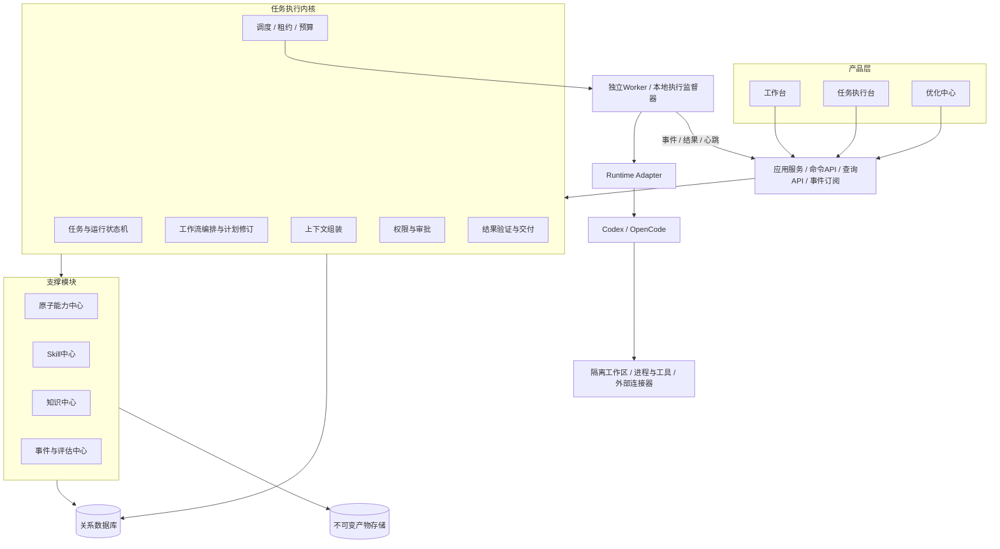
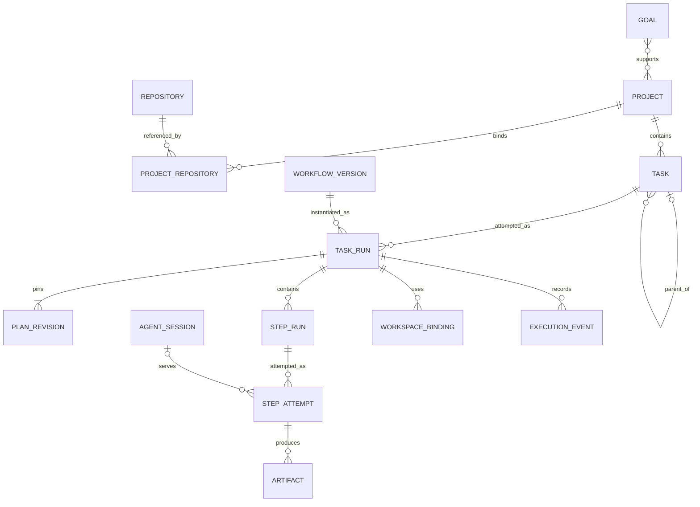
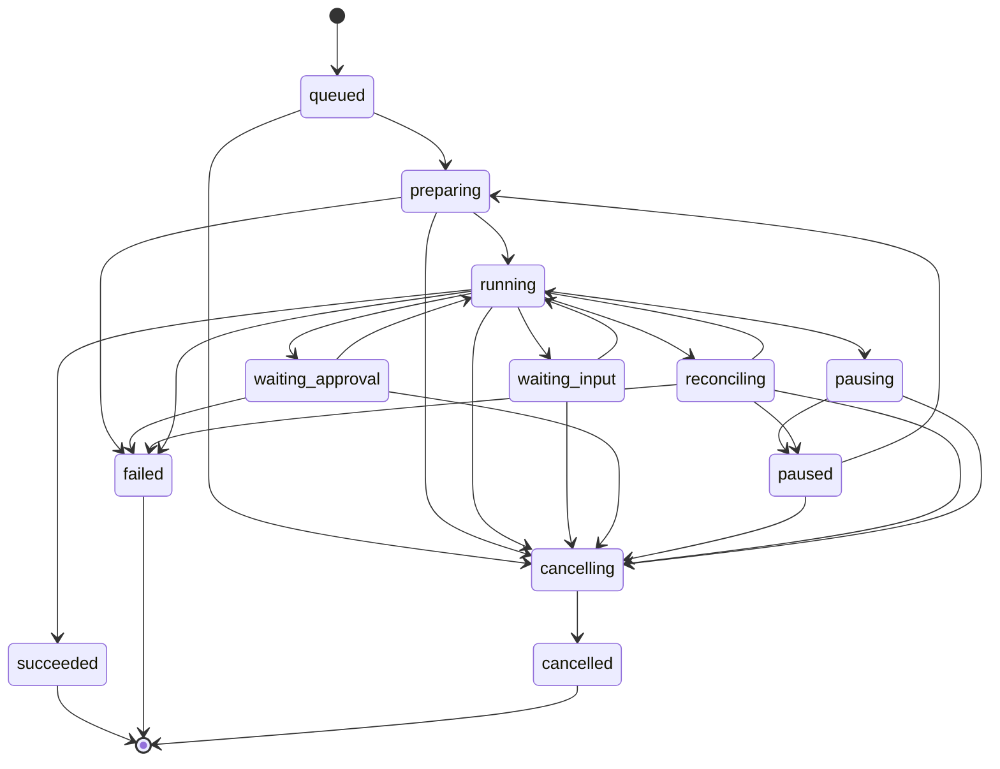
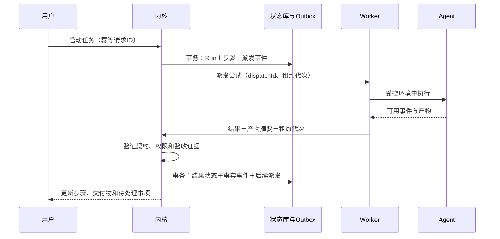

# AI Work OS：平台功能与架构完整设计稿

版本：v1.0 · 日期：2026-11-08 · 适用范围：个人程序员，多项目、多仓库，本机优先

设计状态：可进入实现拆分的设计基线。原对话已确定的方向继续沿用；本稿补充的技术方案、默认值与分期属于本次设计建议，尚未经运行验证。

## 1. 产品定位与设计结论

AI Work OS 将程序员的日常工作组织成“收集—规划—执行—验证—交付—反馈—改进”的闭环。

工作台负责决定做什么、何时做、怎样算完成；任务执行台负责展示和控制一次具体执行；优化中心负责根据任务证据改进平台的执行方法。三个模块共享同一任务体系、执行内核和事实记录。

平台控制工作流、状态转换、权限、预算和验收。Agent 在授权的步骤内选择工具、分析问题、修改代码并提交结构化结果。原子能力定义可调度的业务操作，Skill 提供执行方法，知识提供有来源的事实；三者独立管理、组合使用。

首版采用模块化单体控制服务、独立 Worker 进程、关系型状态存储和文件产物存储。先完成需求开发闭环，再增加故障诊断和经过评估的持续优化。

### 1.1 原有共识与本次补充

| 设计项 | 原对话共识 | 本次细化与优化 |
|---|---|---|
| 产品结构 | 工作台、任务执行台、优化中心 | 明确页面、输入输出与闭环验收 |
| 管理层级 | 目标→项目→任务→子任务→原子执行单元 | 保留导航层级，区分业务任务树和运行步骤图 |
| Agent 自主权 | 平台控制大流程，步骤内部自主执行 | 用权限契约、预算、验证器和变更提案落实 |
| 工作流 | 标准模板＋受控动态调整 | 模板版本、运行图版本、追加修复步骤、不可变历史 |
| 隔离与恢复 | 任务级 Worktree、步骤级 Session | 每个 TaskRun/仓库独立工作区，区分 Session 与执行尝试 |
| 能力体系 | 原子能力、Skill、知识独立 | 增加契约、依赖解析、冲突处理、快照与证据有效期 |
| 优化 | 低风险自动更新，高风险人工审核 | 明确风险判据、离线评估、灰度、回滚；先建立证据再启用自动发布 |
| 部署 | 本机优先，预留远程 Worker | 首版本地 Web＋控制服务＋Worker，远程仅预留协议 |
| 人机协作 | 助手、员工、团队混合模式 | 前两种先实现，多 Agent 团队协作后续扩展 |

### 1.2 成功定义

1. 一项真实需求能从收件箱进入计划，由 Agent 执行，提供可检查的变更和测试证据，最终由验收策略关闭任务。
2. 中断、失败、暂停、重试和人工接管不会丢失已提交的事实，不会静默重复外部写操作。
3. 用户随时能看到当前状态、阻塞原因、预算、交付物以及下一项需要人的决定。
4. 每项优化都能追溯到具体问题和评估样本，能够解释发布理由并回滚版本。

### 1.3 范围与非目标

覆盖需求开发、故障诊断及普通人工任务；支持一个项目关联多个仓库、跨任务依赖和个人任务并发。没有仓库的任务可以只管理清单、文档和人工步骤，无需创建 Worktree。

首版不建设企业多人组织权限、完整 IDE、通用低代码流程编辑器、分布式微服务平台或无人值守生产运维。合并、发布、部署是可选的独立操作，不是“开发任务完成”的隐含副作用。平台代码自我修改只在后期生成独立改进任务，经正常开发流程交付。

## 2. 产品功能设计

### 2.1 工作台：从日常输入到可执行任务

| 功能 | 用户操作 | 结果与规则 | 阶段 |
|---|---|---|---|
| 任务收件箱 | 快速输入文字、粘贴链接、添加本地附件 | 保留原始材料；AI 提取建议标题、类型、项目，来源内容不能直接触发执行 | M1 |
| 目标与项目 | 建立目标、项目、仓库关联 | 项目保存运行环境、测试入口、默认策略和知识范围 | M1 |
| 任务整理 | 分类、去重、优先级、截止日期 | 合并相似任务须保留原来源；不因 AI 建议静默删除任务 | M1 |
| 任务规划 | 拆子任务、填写验收项、建立依赖 | 业务子任务须有独立交付价值；步骤由执行模板生成 | M1 |
| 今日/本周计划 | 选择任务，调整顺序与工作量估计 | AI 给出建议，人可直接调整；估计与真实耗时分列 | M1 |
| 执行准备 | 选择模板、执行器、预算、授权范围 | 显示准备检查结果；缺必要信息时标明阻塞项 | M1 |
| 跟踪与协作 | 看板、运行队列、人工接管、待处理事项 | 单独展示“执行失败”“等待输入”“等待验收” | M1 |
| 总结反馈 | 查看日报/周报草稿、评价结果和返工原因 | 汇总来自真实任务事件，区分已完成、进行中与推测 | M1基础/M3分析 |
| 周期任务 | 配置重复任务及周期回顾 | 每个周期生成新 Task；去重、漏触发补偿、禁用控制 | M2 |
| 外部导入 | 从 Issue 等连接器导入 | 保存外部 ID，按来源去重；外部同步单独授权 | 后续 |

任务进入 ready 的最小条件：明确目标、类型、项目或个人范围、验收标准、执行方式、预算和权限。普通人工任务只要求清晰目标和完成条件。

项目初始化采用引导式配置：选择仓库→检查基线与工作区状态→配置启动/测试入口→建立项目说明→验证 Agent 环境。已有未提交修改只显示提示；不自动清理或覆盖。需要携带的修改必须形成显式输入快照。

### 2.2 任务执行台：同一内核，不同业务视图

所有执行台共用运行摘要、步骤图、时间线、输入输出、权限决策、预算、阻塞处理和产物浏览器。按任务类型增加专用视图。

| 维度 | 需求开发执行台 | 故障诊断执行台 |
|---|---|---|
| 主对象 | 验收项、代码变更、测试证据 | 故障时间线、假设、证据、结论 |
| 核心视图 | 验收矩阵、Diff、测试、审查意见 | 假设—证据矩阵、调用链、日志片段、验证实验 |
| 人的参与 | 澄清需求、处理取舍、验收成果 | 提供现象/数据、确认实验权限、判断业务影响 |
| 交付 | 变更包、验证报告、使用说明、遗留项 | 诊断报告、证据链、确定性、修复建议、复盘 |
| 完成条件 | 所有必选验收项通过或有明确豁免 | 可得出有证据的根因，也可交付证据不足的诊断结论 |

执行台操作语义：

- **补充信息**：添加任务材料和输入版本；若影响当前执行，生成计划变更，不直接修改正在使用的快照。
- **暂停**：停止派发新步骤，运行中的步骤到检查点后停止；提供“立即中断”选项并提示当前结果需复核。
- **恢复**：核对工作区、租约、权限、版本和预算，恢复旧 Session 或重建上下文。
- **重试步骤**：为相同输入创建新尝试；输入或方案改变时应创建修复步骤。
- **人工接管**：先停止 Agent 并转移工作区写权限，再允许人在隔离工作区修改；交回时保存 Diff 并重新验证。
- **取消执行**：终止本次运行，保留已产生结果；任务本身可继续规划。
- **验收/退回**：选择具体交付包和验收项。退回理由作为下一次运行的输入。

### 2.3 优化中心：从记录到经过验证的改进

| 功能 | 输入 | 输出与约束 |
|---|---|---|
| 执行概览 | 运行、验收、成本、干预事件 | 按项目、模板、Skill、执行器版本统计，展示样本数 |
| 问题聚类 | 失败原因、重复步骤、用户反馈 | 可追溯的失败模式、知识缺口和候选机会 |
| 优化提案 | 证据、影响范围、预期收益 | 目标版本、改动、风险、评估计划和回滚方案 |
| 候选生成 | 当前 Skill/知识/工作流 | 新候选版本，不能覆盖正在使用的版本 |
| 对比评估 | 固定案例和环境 | 基线/候选配对结果、失败样本、不确定性 |
| 发布管理 | 评估结果和风险判定 | 拒绝、人工发布、有限灰度或低风险自动发布 |
| 效果追踪 | 新运行及验收反馈 | 回归检测、扩大范围、暂停发布、版本回滚 |
| 周期分析 | 用户配置的周期及运行水位 | 生成分析批次；同一窗口只分析一次，空窗口不重复提醒 |

本设计定义周期机制，不在本次设计交付中创建任何定时自动化。默认建议每周生成一次改进报告；只有预先启用的低风险策略才允许自动发布。

## 3. 信息架构与关键交互

### 3.1 导航结构

```text
工作台
  今日 / 收件箱 / 任务与看板 / 目标与项目 / 总结
执行台
  执行队列 / 任务运行详情 / 交付与验收
优化中心
  执行分析 / 优化提案 / 评估对比 / 发布与回滚
资源与设置（支撑入口，不增加第四个核心产品模块）
  工作流 / 原子能力 / Skills / 知识 / Agent 与环境 / 授权与预算
全局待处理
  缺少信息 / 审批请求 / 执行异常 / 待验收
```

### 3.2 执行台页面草图

```text
┌────────────────────────────────────────────────────────────────┐
│ 项目 / 任务 / 第3次运行     执行中：测试验证       暂停  取消     │
│ 已用 12分 / 预算40分       费用：估计值           当前阻塞：无   │
├───────────────┬───────────────────────────────┬────────────────┤
│ 步骤与依赖    │ 主工作区                       │ 当前上下文     │
│ ✓ 需求分析    │ [验收] [Diff] [测试] [审查]    │ 目标与约束     │
│ ✓ 代码分析    │ 或 [假设] [证据] [实验]        │ 输入与来源     │
│ ✓ 方案设计    │                               │ Skill版本      │
│ ✓ 实现        │ 当前产物及验证结果             │ 授权与预算     │
│ ● 测试验证    │ 每项结论可展开原始证据         │ 待处理事项     │
│ ○ 审查/交付   │                               │ 补充信息       │
├───────────────┴───────────────────────────────┴────────────────┤
│ 时间线：事实事件 / 流程变更 / 人工操作 / 可用的Agent输出          │
└────────────────────────────────────────────────────────────────┘
```

用户默认先看到结果和需要决策的内容，原始终端输出放在可展开区域。状态同时用文字和图标表达；长日志采用分页/虚拟列表，错误显示恢复操作。没有运行时展示“准备执行”；断线时显示最后更新时间并尝试续传，不能把连接断开显示成任务失败。

### 3.3 关键用户旅程

**开发需求**：收件箱输入→确认目标与验收→选择项目和授权→检查准备结果→启动执行→查看变更和测试→处理必要取舍→验收交付→选择是否另行提交远端。

**故障诊断**：登记现象和时间范围→导入脱敏证据→生成假设→查看验证计划→执行许可范围内检查→形成结论与未知项→可选创建修复任务→关联复盘。

**优化发布**：查看“某 Skill 的返工率偏高”→查看样本及原因→生成候选→运行对比评估→检查收益和退化→按策略发布→观察新任务→必要时回滚。

审批卡片必须展示“具体动作、目标资源、变更内容、风险原因、已有授权、有效期”。已有授权覆盖的动作直接记录授权命中，不重复打断用户。批准绑定动作摘要和版本；审批后内容变化则不能复用旧批准。

## 4. 总体架构



### 4.1 模块边界

| 模块 | 拥有的规则与数据 | 对外契约 |
|---|---|---|
| 工作管理 | Goal、Project、Task、依赖、计划、反馈 | 创建/规划/验收任务 |
| 执行内核 | Run、步骤图、尝试、调度、状态转换 | 启动/暂停/恢复/取消/变更计划 |
| 权限服务 | 策略、授权、审批、动作摘要 | 判断 allow / deny / require_approval |
| 运行时与工作区 | Worker、Session、工作区租约、执行器适配 | 执行、观察、停止、恢复能力声明 |
| 能力/Skill/知识 | 契约、发布版本、知识条目、上下文包 | 解析依赖、冻结版本、检索和提交候选 |
| 事件/产物 | 事实事件、日志片段、文件、验证结果 | 追加、索引、查询、完整性校验 |
| 评估/优化 | 案例、评估、提案、发布指针 | 比较、发布、回滚 |

模块在同一代码仓库和控制服务内，通过明确接口协作；禁止 UI 或 Agent 直接更新数据库状态。首版只有控制服务写数据库；Worker 通过经过鉴权的内部协议回传事实。

### 4.2 控制面和执行面

控制服务是运行状态与权限的唯一权威；Worker 是执行者。Worker 崩溃不能让平台失去任务历史，控制服务重启不能让旧 Worker 继续无限执行。

Worker 接收不可变的执行信封：输入引用、工作区、上下文摘要、能力版本、权限、预算、截止时间、attemptId 与租约代次。Worker 返回证据和候选结果；内核验证后决定步骤完成与后续调度。

## 5. 领域模型

### 5.1 区分业务任务树与执行步骤图

“目标→项目→任务→子任务”用于表达工作意图与交付责任；“TaskRun→工作流图→StepRun→StepAttempt”用于表达执行过程。

子任务有独立目标、验收和生命周期。StepRun 是一次运行中的操作步骤，例如分析影响范围、执行回归测试。不能因为一个模板有七个步骤，就自动产生七个业务子任务。

Goal 与 Project 可多对多关联，以支持同一项目服务多个目标；项目任务有一个主项目，可以通过仓库绑定引用该项目的多个仓库。个人任务允许 projectId 为空，使用个人知识与授权范围；图中展示的是项目任务关系。跨项目任务拆成关联子任务，由父任务统一验收。导航保留原有层级，数据库不强制将所有关系压成单棵树。



### 5.2 核心实体及关键字段

| 实体 | 关键字段 | 不变量 |
|---|---|---|
| Goal | id、目标、周期、成功标准、关联项目 | 不用步骤完成率代替目标结果 |
| Project / Repository | id、路径/远端标识、环境配置、策略、知识范围 | 仓库身份与本地路径分离 |
| Task | id、parentId、type、objective、acceptanceCriteria、status、revision | 验收项和输入修改有版本 |
| TaskDependency | predecessor、successor、requiredOutcome | 与父子关系独立，禁止循环依赖 |
| TaskRun | id、taskRevision、workflowVersion、status、budget、manifestId | 一次正式尝试，不覆盖历史运行 |
| PlanRevision | runId、revision、graph、reason、previousRevision | 图版本不可变，激活指针可更新 |
| StepRun | id、runId、nodeKey、capabilityVersion、dependsOn、status | 逻辑步骤，包含多次执行尝试 |
| StepAttempt | id、stepId、ordinal、inputDigest、leaseEpoch、status | 每次派发一个唯一尝试 |
| AgentSession | id、providerSessionId、runtimeVersion、contextDigest | 会话不等同于任务或步骤 |
| WorkspaceBinding | runId、repoId、baseCommit、path、branch、writeLease | 同一工作区同时只有一个写者 |
| CapabilityVersion | id、version、inputSchema、outputSchema、effects、validators | 版本不可变，声明不替代执行时校验 |
| SkillVersion | id、version、digest、dependencies、testCases、status | 发布后不可原地编辑 |
| KnowledgeItem/Revision | scope、type、content、sources、validity、status | 假设不能作为已验证事实发布 |
| ContextPackage | manifest、references、tokenEstimate、digest | 每个尝试可还原实际输入来源 |
| Artifact / CheckResult | digest、producerAttempt、type、subjectDigest、status | 测试证据绑定具体代码/输入摘要 |
| Approval / Grant | actionDigest、scope、expiry、policyVersion、decision | 过期或目标改变后不可复用 |
| ExecutionEvent | id、runId、seq、type、actor、payloadRef | 按运行顺序追加、去重接收 |
| ImprovementProposal | target、evidenceRefs、candidateVersion、risk、status | 原因、实验、发布可追溯 |
| EvaluationRun / Release | datasetVersion、baseline、candidate、metrics、scope | 评估与发布分离 |

每个 Task 默认最多一个活跃 TaskRun。要比较两个方案时，显式创建独立运行和独立工作区，并指定哪一份交付被验收。父任务的必需子任务全部验收后，父任务仍须通过自身集成验收；禁止父任务执行和子任务执行同时修改同一工作区。

## 6. 生命周期与状态转换

### 6.1 Task：业务状态

`inbox → planned → ready → in_progress → awaiting_acceptance → done`

旁路状态为 `blocked`、`cancelled`。依赖未完成、缺必要材料时进入 blocked 并保存原因及原状态；解除后重新检查 ready 条件。执行失败不会自动把业务任务取消。TaskRun 成功只代表交付包就绪，Task 是否 done 由验收策略决定。

人工任务可从 in_progress 直接提交交付进入 awaiting_acceptance。退回验收进入 planned 或 ready 并增加任务版本；done 任务重新打开必须记录理由和新版本。默认由用户验收，预授权的客观任务可由机器验收规则完成。

### 6.2 TaskRun：一次运行的状态



waiting_input / waiting_approval 仅在没有其他可执行步骤时作为运行摘要；部分分支等待而其他步骤仍运行时，TaskRun 保持 running 并展示分支阻塞。拒绝审批可选择替代计划继续；无可行计划才 failed。等待超时按模板进入 paused 或 failed。

图中展示主路径。补充规则：任何尚未终止且持有执行资源的状态，出现执行归属或副作用不明时先进入 reconciling；queued/preparing 的前置校验失败可直接 failed；等待状态超时仅在没有活跃执行时转 paused/failed。取消期间的核对保留 cancelling 及阻塞原因，不能因收到迟到成功事件转为 succeeded。所有失败终态都要求已解除活跃执行或明确封锁遗留资源。

终态不可改回 running。终态后的重跑创建新 TaskRun，并可引用旧产物作为显式输入。未终止运行中的瞬态失败可创建新的 StepAttempt。

### 6.3 StepRun 与 StepAttempt

StepRun 状态：`pending / ready / running / waiting_input / waiting_approval / retry_wait / paused / succeeded / failed / skipped / cancelled / superseded`。

StepAttempt 状态：`leased / executing / verifying / succeeded / failed / interrupted / unknown / cancelled`。unknown 表示无法确认执行结果，必须核对，不能按失败盲目重试。

只有完成输出 Schema 校验、产物校验和验收检查后才允许 succeeded。进程退出码为 0、Agent 声称完成、输出 JSON 合法，都不是单独的成功条件。

运行成功需满足当前激活计划中的所有必需节点和最终交付验证；被替代的旧节点保留在历史中。进度展示“当前计划完成 n/m 项”和计划变更次数，允许重新规划后比例变化。

## 7. 工作流编排与动态调整

### 7.1 模板规范

工作流模板必须版本化。节点可以是原子能力调用、人工输入、验证器或授权检查。依赖图使用有向无环图，条件边使用受限表达式，不能执行任意代码。

以下为平台自定义协议示例，不是现有执行器 API：

```yaml
id: feature-development
version: 1.0.0
inputs: [taskRevision, repositoryBindings, acceptanceCriteria]
limits:
  maxPlanRevisions: 5
  maxAddedNodes: 10
  maxAttemptsPerStep: 3
nodes:
  - id: analyze
    capability: code.impact-analysis@1.0.0
    effects: [read_workspace]
  - id: design
    capability: solution.design@1.0.0
    dependsOn: [analyze]
  - id: implement
    capability: code.implement@1.0.0
    dependsOn: [design]
    effects: [write_workspace]
  - id: test
    capability: test.regression@1.0.0
    dependsOn: [implement]
    required: true
  - id: review
    capability: code.review@1.0.0
    dependsOn: [test]
    required: true
  - id: deliver
    capability: delivery.package@1.0.0
    dependsOn: [review]
    required: true
```

以上限额是起始默认建议。预算还包括总运行时间、输出大小、并发数和可观测的 Token/费用；后续依据实际任务调整。没有费用数据时显示未知，不能把未知当成零。

### 7.2 调度规则

1. 检查依赖结论、运行状态、预算和授权，计算可执行节点。
2. 按用户优先级、等待时长和资源占用选择节点；同优先级按入队时间调度，加入老化机制避免饥饿。
3. 在事务中获得尝试租约、工作区写租约和预算预留，生成执行信封及派发记录。
4. Worker 接受后启动执行并报告心跳；重复派发使用同一 dispatchId 去重。
5. 结果回传后由内核验证，保存状态与事件，释放资源并激活后续节点。

只读分析可并发；会写文件的构建和测试也视为写操作。同一工作区不得将写入和非快照读取混跑，避免读取到半成品。需要并发测试时用独立快照工作区。

### 7.3 动态变更协议

Agent 提交 PlanChangeProposal：`runId、expectedRevision、原因、证据引用、节点增删/替代方案、预算增量、权限变化、受影响产物`。

内核检查节点合法性、依赖无环、必要验收未绕过、预算边界、权限范围及产物失效范围，然后接受、拒绝或请求超出已有授权部分的批准。采用版本比较交换，旧版本提案返回冲突并重新生成。

所谓“回到分析”，实现为追加 `analyze-2 → implement-2 → test-2` 并建立新计划版本；不会擦掉第一次分析和测试记录。受影响后续节点标记 superseded，已有测试产物仍可查看，但不再证明新代码有效。正在运行且将被替代的节点先停止并核对，不能一边改图一边让旧写任务继续执行。

允许自动执行的典型调整：授权内的只读检查、预算内追加必要验证、瞬态失败的有限重试。跳过必需测试、扩大写范围、改变外部动作、增加预算或改变交付目标必须重新判断权限，不能靠“优化流程”绕过约束。

### 7.4 重试、重做与补偿

| 情况 | 处理 |
|---|---|
| 限流、短暂网络中断，确认无副作用 | 同输入重试，指数退避和抖动，建议最多三次总尝试 |
| 输出 Schema 错误 | 允许一次有预算的格式修复；仍失败则暴露协议错误 |
| 测试发现实现错误 | 新修复步骤和新输入摘要，不能把它算网络重试 |
| 操作已发出但结果不明 | 标为 unknown，先按外部操作 ID 查询、核对 |
| 已发生外部写操作 | 使用能力专属补偿方案或人工处理，不能泛化为事务回滚 |
| 需求或验收变化 | 创建任务/计划新版本，重新判断已有证据是否有效 |

“原子能力”指稳定的调度与业务契约边界，不承诺跨文件、Git、远端服务的数据库式原子性。

## 8. Agent Runtime 与执行环境

### 8.1 平台适配器契约

下列接口由平台定义，通过适配器实现；不假设 Codex 与 OpenCode 原生具有相同 API。

```typescript
type Support = "native" | "emulated" | "unsupported";

interface RuntimeCapabilities {
  structuredEvents: Support;
  structuredResult: Support;
  resumeSession: Support;
  cancelExecution: Support;
  usageReporting: Support;
  toolAudit: "full" | "partial" | "none";
  permissionEnforcement: "sandbox" | "broker" | "none";
}

interface ExecutionEnvelope {
  dispatchId: string;
  attemptId: string;
  leaseEpoch: number;
  capabilityVersion: string;
  inputArtifactIds: string[];
  contextPackageId: string;
  workspaceBindings: string[];
  policySnapshotId: string;
  deadline: string;
  limits: { maxOutputBytes: number; maxTokens?: number };
}

interface AgentRuntimeAdapter {
  probe(): Promise<{ version: string; capabilities: RuntimeCapabilities }>;
  start(input: ExecutionEnvelope): Promise<{ handle: string; sessionId?: string }>;
  events(handle: string, cursor?: string): AsyncIterable<RuntimeEvent>;
  inspect(handle: string): Promise<ExecutionObservation>;
  cancel(handle: string): Promise<{ stopped: boolean; outcomeKnown: boolean }>;
  resume?(sessionId: string, input: ExecutionEnvelope): Promise<{ handle: string }>;
}
```

`RuntimeEvent` 至少统一为 started、output_chunk、tool_observed、usage、permission_required、completed、failed；保留原始事件类型和原始载荷引用。未知事件可以存档，但不能据此推断成功。`ExecutionObservation` 区分 alive、stopped、unreachable、unknown。

### 8.2 已核实能力与接入边界

| 执行器 | 已核实入口 | 平台接入方式 | 仍需验证 |
|---|---|---|---|
| Codex | `codex exec`，JSONL 事件，按会话 ID 恢复；本机帮助还列出输出 Schema 和工作目录参数 | 首版使用 CLI 子进程，明确设置工作目录、受控配置、输出文件与 Schema | 锁定版本下的事件格式、异常退出、权限阻塞、取消、恢复及用量字段 |
| OpenCode | `opencode run`，JSON 输出，按指定 Session 续接 | CLI 适配；对服务型运行明确服务归属和会话隔离 | 目标版本的私有服务方式、终止会话、工具审计和权限执行行为 |

Codex 官方文档明确支持非交互执行、JSONL 和 resume；本稿同时核对了本机 `codex exec --help`，未调用模型进行执行验证。[OpenAI 官方开发命令文档](https://learn.chatgpt.com/docs/developer-commands#codex-exec)

OpenCode 官方文档说明非交互入口、JSON 和指定会话参数；其当前 CLI 文档也描述共享后台服务和私有服务模式。因此，适配器不能把“CLI 进程退出”直接等同于“服务端执行已经停止”。接入时必须核对所安装版本。[OpenCode Commands](https://opencode.ai/docs/cli/commands/)、[OpenCode CLI](https://opencode.ai/docs/cli/)

平台不使用“恢复最近一次会话”来选择执行目标，只使用绑定的明确 Session ID。平台统一管理 Worktree 生命周期，不同时启用执行器自动创建工作区，避免两套清理和恢复规则冲突。未知执行器版本先通过兼容性测试后加入可运行清单。

### 8.3 Session 与上下文恢复

默认一个步骤一个 Session；同一步骤的延续尝试可复用会话，前提是运行版本、工作区、权限和上下文兼容。跨步骤复用作为后续优化，必须记录追加的上下文，不能隐含继承已失效授权。

恢复优先顺序：

1. 核对旧执行是否仍在运行、工作区内容是否改变、外部副作用是否确定。
2. 原生会话可恢复且策略兼容时，使用绑定 ID 续接。
3. 否则用目标、验收、固定版本、已验证事实、产物、当前 Diff、未解决问题重建会话。
4. 输入不完整或结果不明时进入人工核对，不伪造“恢复成功”。

恢复不是保证模型给出相同输出；平台保证输入与证据可追溯、状态可核对。远端模型的完全确定性重放不作为产品承诺。

### 8.4 工作区与多仓库

每个 `TaskRun × Repository` 创建独立 WorkspaceBinding，记录基线 commit 和任务分支。一个运行涉及多个仓库时使用 WorkspaceSet，并将各仓库版本共同写入运行清单。

Git Worktree 的部分仓库数据和引用是共享的，适用于分离工作目录，但不能充当安全沙箱。[Git Worktree 官方文档](https://git-scm.com/docs/git-worktree)

据此，本平台作如下设计：

- 文件、网络和命令权限由经过验证的执行器沙箱、系统隔离或工具代理落实；提示词中的“不要访问”不能视为强制限制。
- 仓库共享引用操作由工作区管理器串行化。平台管理分支创建、基线固定和清理；Agent 不得任意修改其他任务分支。
- 锁和租约只能阻止遵守协议的执行者；需配合进程/服务停止确认。旧写进程未停止时，不能发放新的工作区写权限。
- 每次测试记录代码摘要，含未提交变更及相关未跟踪文件；测试进程可能写缓存和产物，必须在允许路径内运行。
- 多仓库交付记录变更集合及应用顺序；外部合并不承诺跨仓库原子提交。部分成功时进入核对/补偿流程。
- 清理只处理平台拥有且已解除租约的路径；先归档必要产物，检查未提交内容、未推送提交及保留策略，再释放 Worktree。

没有可靠权限限制能力的 Adapter 不能运行要求强隔离的任务。首版可支持受信任的本地工作区执行模式，但页面和运行清单必须明确其边界；只读意图也不能替代实际限制。

### 8.5 资源、凭据与环境

建议初始全局并发为 2、每个工作区写并发为 1；测试进程、端口、CPU/内存和模型调用限额各自计入资源预算。执行器所需运行环境由项目配置引用锁文件或镜像摘要，记录操作系统、工具版本与环境变量白名单。

认证材料存储在操作系统凭据库或既有执行器凭据机制中；执行信封只传凭据引用。远端写权限尽可能放在专用连接器，避免赋予整个 Agent Shell。项目文档、代码注释、日志和外部网页均按输入材料处理，不能提升权限或覆盖平台控制指令。

## 9. 持久化执行、失败恢复与幂等

### 9.1 一致性方案

首版采用“关系型当前状态＋追加事件＋事务 outbox”，不引入完整事件溯源框架。

同一个数据库事务写入状态变化、ExecutionEvent 和待派发 outbox。派发器处理 outbox，并以 dispatchId 防重复。Worker 事件采用至少一次投递；内核按 `(workerId, eventId)` 去重，按运行生成单调递增 seq，使用 attemptId 和 leaseEpoch 拒绝过期执行者的结果。

不承诺分布式 exactly-once。可安全重试的操作依靠幂等键；无法确认的外部副作用通过核对解决。



文件与数据库不能组成同一个普通事务：产物先写暂存区，计算摘要并完成持久化，原子重命名到内容寻址位置，再在事务中登记引用。失败可能留下孤立文件，由延迟清理回收；不得发布指向未完成文件的成功结果。

### 9.2 外部动作账本

每个有副作用的外部操作记录 `operationId、idempotencyKey、requestDigest、target、authorizationRef、state、receipt`。状态包括 prepared、sent、confirmed、unknown、compensated。

同一动作重试复用幂等键；请求内容变化必须新建动作。远端支持幂等时携带键，不支持时先查找确定性的目标标识或外部回执。不能可靠去重且结果不明时停止自动重试。

平台在发起动作前保存 prepared，发送前标记 sent，收到响应后保存 confirmed。发送与记账之间的崩溃窗口通过 unknown 和核对流程处理。Git 推送、PR 创建、部署等都遵循该规则。

### 9.3 失联与崩溃处理

| 故障 | 状态与恢复规则 |
|---|---|
| 浏览器断线 | 运行继续；重连按事件游标续读，必要时取最新快照 |
| 控制服务重启 | 扫描非终态 Run、outbox、租约，进入 reconciling 后核对 |
| Worker 失联 | 不立即重跑；核对进程、服务 Session、工作区与外部动作 |
| Agent 进程崩溃 | 保存部分日志和 Diff；可重试步骤创建新 Attempt |
| 服务型执行器失联 | 必须核对服务端任务是否仍运行；不以本地 PID 结果替代 |
| 写文件后未回报 | 比较执行前后内容摘要；把未验证变更作为候选结果 |
| 产物写入失败/磁盘满 | 停止新派发，保留状态；成功条件不能绕过产物持久化 |
| 用户手工修改运行目录 | 检测摘要漂移，暂停受影响写步骤并请求合并判断 |
| 取消后收到迟到结果 | 保留审计，拒绝推进状态，核对已经发生的副作用 |

建议心跳周期 10 秒、租约有效期 45 秒、失联核对目标 60 秒；这些是初始工程参数。Worker 的监督器须在租约过期时停止继续执行，包括其拥有的子进程或服务 Session。无法确认停止时保持工作区封锁，不能只因时间到了就重新派发写任务。

### 9.4 暂停、取消与预算

暂停首先撤销新派发资格，待运行步骤停止后才显示 paused。取消过程保留 cancelling，直到执行已停止且未决副作用被标记；有待核对动作时显示明确阻塞原因。

预算在派发前预留，结束后按实际可得用量结算。费用只能估计或用量延迟上报时，平台可强制控制时间和并发，但不能声称精确到金额的实时硬限制。达到阈值停止新派发，按执行器支持程度中断当前执行；扩大预算沿用已有授权或请求新增授权。

## 10. 原子能力、Skill 与知识协作

### 10.1 各自职责

| 对象 | 回答的问题 | 例子 |
|---|---|---|
| Capability | 平台可以调度什么业务操作，怎样验证结果 | 代码影响分析、实现变更、回归测试、故障假设验证 |
| Skill | 这个操作应该遵循什么方法 | Java API 设计规范、日志排查方法、测试策略 |
| Knowledge | 当前有哪些有来源的事实与约束 | 模块架构、业务规则、事故记录、当前任务发现 |
| Workflow | 什么条件下执行哪个操作 | 分析→实现→测试→审查→交付 |
| Tool | 具体如何访问资源 | 文件读取、代码搜索、Shell、日志查询 |
| Agent | 如何理解材料并完成当前操作 | 在能力契约和权限内规划工具调用 |

原子能力由代码注册并定义输入、输出、权限、预算、超时、验证器与副作用类型；执行实现可为确定性代码、Agent 委托或人工动作。不是把所有读文件、搜索和 Shell 指令都编排成工作流节点。

### 10.2 原子能力契约

能力定义包含：稳定 ID/版本、输入输出 JSON Schema、实现类型、依赖 Skill、允许知识范围、资源声明、可重试条件、幂等策略、补偿说明、输出验证器。

统一结果包含 `status、summary、artifactRefs、checkResults、evidenceRefs、unknowns、knowledgeCandidates、planChangeProposals、usage`。Agent 不能直接把 knowledgeCandidates 写成已发布知识，也不能直接激活计划变更。

初期能力集合：

| 领域 | 能力 |
|---|---|
| 需求 | requirement.normalize、code.impact-analysis、solution.design |
| 开发 | code.implement、test.regression、code.review、delivery.package |
| 诊断 | incident.collect、incident.hypothesize、incident.verify、incident.report |
| 优化 | trace.analyze、improvement.propose、evaluation.compare |

### 10.3 Skill 生命周期

`draft → validating → candidate → published → deprecated / revoked`。

Skill 包包含说明正文、适用范围、依赖能力、版本清单、示例、固定评估案例和兼容性声明。发布版本以内容摘要标识；修改产生新版本。项目可以选择全局版本或项目覆盖，但最终解析结果必须唯一且明确。

冲突处理：平台权限和任务验收最高优先；项目规则不能扩大授权；Skill 与任务目标冲突时暴露冲突，不通过堆叠提示词自行猜测。跨 Skill 依赖须验证兼容范围并冻结版本。

发布新版本只影响之后创建的运行。严重风险撤销可暂停引用旧版本的运行，经审查后重建上下文；普通回滚不静默替换运行中的内容。

### 10.4 知识模型与沉淀

采用两个正交维度，避免“范围”和“生命周期”混在一起：

- 范围：全局、项目、仓库、任务、运行。
- 类型：规范、已验证事实、决策、假设、经验、原始证据。

每条知识记录来源、作者/生成者、验证状态、适用版本/commit、观测时间、失效条件和敏感级别。长期知识是经验证且跨任务复用的内容；任务知识是当前目标相关材料；执行知识是本次运行形成的发现，默认尚未升级为长期知识。

沉淀流程：候选→证据校验→去重/冲突检测→确定适用范围→发布新修订。冲突事实并列呈现来源和时间，不按“最新一条”直接覆盖。代码改变可让架构知识进入待复核；证据过时、被撤销或来源不可用时降低使用资格。

首版以结构化标签、范围过滤和全文检索为主；语义向量检索在实际召回需求出现后增加。相关性分数不能替代证据有效性。

### 10.5 上下文组装

按固定顺序组装：平台约束→任务与验收→步骤契约→项目规则和 Skill→相关已验证知识→上游产物→必要的原始材料。检索材料带来源与可信类型，和控制指令分区。

每个 ContextPackage 保存实际引用版本、截取范围、来源摘要、组装策略版本、预算与删减记录。优先保留验收、权限、必要事实和未决问题；空间不足时压缩低优先级材料，不静默截断关键约束。

RunManifest 固定初始输入和版本；运行中新事实以追加产物产生，后续步骤可以引用它们，但不改写历史快照。上下文恢复使用结构化交接包，不只依赖聊天摘要。

## 11. 两类任务的详细流程与交付标准

### 11.1 需求开发

| 步骤 | 输入 | 输出 | 通过条件 |
|---|---|---|---|
| 需求分析 | 原始描述、业务材料 | 目标、约束、验收清单、未知项 | 必要条件清晰，关键歧义得到解决或显式阻塞 |
| 代码分析 | 固定仓库基线、项目知识 | 影响模块、依赖、风险、相关测试 | 指向具体代码/文件证据 |
| 方案设计 | 验收、影响分析 | 方案、取舍、变更计划、验证计划 | 在授权和预算范围内，或获得增量授权 |
| 实现变更 | 方案、Skill、工作区 | Diff、说明、实现证据 | 变更在许可范围内，输出完整 |
| 测试验证 | 指定代码摘要、测试计划 | 结构化测试结果、原始日志、环境指纹 | 必选检查通过；未执行项不得计作通过 |
| 代码审查 | Diff、验收、测试结果 | 按严重性划分的问题与处理状态 | 阻断项已修复或获明确豁免；修复后相关测试重跑 |
| 成果交付 | 最终变更与有效检查 | DeliveryPackage | 所有证据对应最终产物摘要 |
| 任务验收 | 交付包、验收清单 | 接受/退回及理由 | 按任务验收策略决策 |

DeliveryPackage 包括仓库基线、最终 commit 或 patch、未跟踪交付文件、变更摘要、逐项验收矩阵、测试环境/命令/退出码/结果、审查意见、未解决问题、使用说明和应用/回退说明。

独立审查可使用新的 Session，以减少上下文偏差，但仍不被视为独立客观证明；机器检查和验收证据优先。首版交付本地变更包，远端提交/PR 可作为另行授权的交付动作。

### 11.2 故障诊断

| 步骤 | 输出与验证 |
|---|---|
| 收集现象 | 时间范围、影响、环境、日志/指标来源；记录缺失数据 |
| 建立背景 | 相关代码版本、配置、变更历史、依赖和时间线 |
| 生成假设 | 每个假设的解释、支持/反证、验证方法和风险 |
| 执行验证 | 优先非侵入检查；每次实验绑定输入、操作、环境和观测 |
| 形成结论 | confirmed / likely / unresolved，列出因果证据和替代解释 |
| 修复建议 | 最小变更、验证方法、影响与回退；可创建关联修复任务 |
| 复盘 | 触发条件、检测缺口、预防建议、知识候选 |

假设记录包含 `hypothesisId、claim、supportingEvidence、contradictingEvidence、nextExperiment、status`。证据包含来源、采集时间、查询条件、原始摘要与适用环境。没有证据的置信度百分比不作为判定依据。

修复不是诊断完成的强制条件。证据不足时，交付“已排除项、仍可能原因、缺失数据和下一步实验”，标记任务目标是否满足；不能为追求完成率编造根因。诊断报告完成率与确认根因率分别统计。

## 12. 执行记录、可观测性与数据治理

### 12.1 记录范围

必须记录：用户输入版本、运行清单、计划变更、状态转换、权限判断、Agent/模型配置、Skill/知识版本、执行器可提供的事件、工具调用可见信息、产物、验证、人工干预、用量和验收反馈。

“全过程记录”指完整记录平台可观测的操作、结果和决策摘要；不要求也不假设能够获得模型内部隐含推理。不同执行器的工具事件可见性不同，RunManifest 保存覆盖率和缺口，缺失不能显示为空操作。

事件公共字段：`eventId、runId、stepId、attemptId、seq、eventType、schemaVersion、actor、observedAt、receivedAt、correlationId、causationId、payloadRef`。UTC 存储，界面按用户时区显示；本设计默认 Asia/Shanghai。

### 12.2 指标与可解释性

| 指标 | 定义 |
|---|---|
| 首次验收通过率 | 首次交付直接被接受的任务数 / 已产生首次验收结论的任务数 |
| 最终任务成功率 | 在观察窗口内满足业务验收的任务数 / 已结束且可判定的任务数；进行中与取消单列 |
| 步骤失败率 | 最终失败的 StepRun / 已终止的有效 StepRun；重试次数另列 |
| 人工干预 | 区分必要审批、信息补充、纠错接管；不能把减少必要审批作为优化收益 |
| 耗时 | 排队、机器执行、等待用户分别展示 |
| 成本 | 已报告用量、估算金额、未知部分分列；价格配置带版本 |
| 证据覆盖 | 有有效来源和验证的必需结论 / 必需结论总数 |
| 诊断效果 | 根因确认率、错误根因率、有效排除项与数据缺口 |

界面允许从指标下钻到具体任务、版本、失败原因和原始证据，不只提供聚合曲线。

### 12.3 日志、隐私与保留

密钥和凭据不写入上下文归档、日志或数据库；日志写入前做规则脱敏，敏感原始证据采用受控文件引用。记录脱敏发生及其对证据的影响。导出交付和评估集前再次检查敏感信息。

建议默认原始执行日志保留 30 天，运行元数据、验收结论与关键交付物长期保留至项目归档；均可配置。已被评估、验收或恢复流程引用的产物不得按日志期限直接删除。清理后保留内容摘要与删除原因，并明确“原始证据已过保留期”，不能宣称仍可完整回放。

## 13. 平台优化与发布治理

### 13.1 闭环与状态

`发现问题 → 建立提案 → 生成候选 → 离线评估 → 风险判定 → 灰度/批准发布 → 在线观察 → 扩大/回滚`。

提案状态为 detected、triaged、candidate_ready、evaluating、rejected、approved、canary、published、rolled_back。分析与生成可以自动完成；发布是否自动由风险规则、评估证据和已有授权共同决定。

### 13.2 风险分类

| 类别 | 典型改动 | 发布策略 |
|---|---|---|
| 低风险 | 修正文档索引、补充经证据验证的非控制性知识、限定范围的上下文排序 | 达到门槛且预授权后，可自动灰度；首版先保留人工发布 |
| 中风险 | 修改 Skill 执行方法、调整步骤顺序、改变检索策略 | 默认人工发布，可在成熟评估后开放特定规则 |
| 高风险 | 扩大权限、删掉验证、扩大网络/文件范围、修改原子能力执行代码或平台代码 | 必须人工审核，通过普通开发流程 |

风险由行为和权限变化决定，不按文件扩展名决定。Skill 中一行指令可能改变外部动作，不因为“只是 Markdown”就归入低风险。发布审核者和策略引擎独立于生成候选的 Agent。

### 13.3 评估设计

固定评估集包含代表性成功、失败、边界、恢复和权限案例，保存基线仓库、输入、预期结果、验证器和环境摘要。候选生成使用开发集；保留未用于生成的留出集，防止针对单个失败案例过拟合。

历史记录有两种使用方式：事件回看只分析既有事实；执行回放则在隔离环境、固定输入、模拟或只读外部连接器中重新运行。默认禁止回放触发真实推送、部署和其他外部写操作。

基线与候选在相同条件下配对评估，记录模型/执行器版本，必要时多次重复以展示波动。模型服务无法固定的变化单独注明，不能把所有差异归功于 Skill。

默认门槛建议：

1. 所有权限、安全和必需验收用例通过，没有新增严重错误。
2. 目标质量指标达到预定义改进值，其他质量指标不超过退化容忍范围；成本收益不能抵消质量失败。
3. 起始基准至少 20 个不同案例，关键案例重复至少 3 次；该数量只作为人工评审起点，不能自动证明统计可靠。
4. 自动发布需要为目标指标设置最小收益、非劣界限和样本量计划，配对置信区间满足门槛；样本不足或区间过宽则继续采样或人工评审。
5. 优化提案必须给出目标范围、观测窗口、失败阈值及可执行的回滚指针。

### 13.4 灰度和回滚

个人低流量场景建议先在选定项目的未来 5 个合格任务中启用候选，保留基线组。5 个任务用于发现明显回归，不作为充分有效性的证明。发现严重失败立即停止新任务采用候选；其余按预先设定的观察标准决定继续采样。

回滚改变发布指针，只影响新运行。已经开始的运行继续固定版本，除非发现严重风险而进入受控暂停。对知识污染的修复通过撤销条目、重建索引和标记受影响上下文完成；不会通过覆盖历史记录掩盖问题。

平台代码自我优化始终产生独立开发任务，经过实现、测试、审查、验收与正常发布；优化器没有直接改写运行控制服务的权限。

## 14. 工程架构与部署方案

### 14.1 首版技术基线

以下是便于个人维护的拟定实现方案，不依赖特定最新版本；进入实现时固定依赖版本并进行兼容验证。

| 层 | 建议方案 | 理由与替换边界 |
|---|---|---|
| 前端 | TypeScript＋React，任务页面与专用执行视图 | 强调数据表、Diff、步骤图和事件流；页面不绑定执行器协议 |
| 控制服务 | TypeScript＋Node.js，模块化单体 | 与前端/契约共享类型；状态转换由纯领域服务控制 |
| Worker | 独立 Node.js 进程，运行时与操作系统监督器适配 | 隔离长任务和子进程故障；与控制服务通过版本化协议通讯 |
| 数据库 | 本机 SQLite，WAL，短事务，控制服务唯一写入入口 | 适合起步的单机管理；保留迁移到 PostgreSQL 的仓储接口 |
| 产物 | 本机文件系统，内容摘要寻址 | 大日志和 Diff 不直接塞进事务表 |
| 队列 | 数据库 outbox＋租约轮询 | 首版无需额外消息中间件 |
| UI 通知 | HTTP 命令/查询＋SSE 增量事件 | 持久事实可按游标恢复；命令与事件通道分离 |
| 搜索 | 结构化索引与全文检索 | 后续按真实需求加入向量检索 |
| 验证 | 领域测试、协议契约测试、恢复故障注入、关键浏览器旅程 | 围绕状态和副作用边界验证 |

SQLite WAL 要求同一主机访问，且同一时刻只有一个写者；因此数据库放在本地磁盘，采用短事务与写入背压，不让远程 Worker 直接打开数据库。[SQLite WAL 官方文档](https://www.sqlite.org/wal.html)

本项目文档当前位于 OneDrive 同步目录。作为本平台的工程策略，活跃数据库、日志缓存和执行工作区应放在非同步运行目录，例如 `%LOCALAPPDATA%\AIWorkOS\`；文档和关闭后导出的备份可同步。这里是本次设计的运行目录建议，不是把 OneDrive 等同于 SQLite 文档中的网络文件系统。

### 14.2 建议代码目录

```text
apps/
  web/                       产品界面
  server/                    API、调度器、事件订阅
  worker/                    执行监督器与内部协议客户端
packages/
  domain/                    状态机、规则、领域对象
  contracts/                 API、事件、能力Schema
  workflow/                  图验证、计划修订、依赖调度
  runtime/                   Adapter协议与执行器实现
  workspace/                 Git、快照、租约与生命周期
  policy/                    授权、审批、动作摘要
  context/                   知识筛选、Skill解析、上下文包
  persistence/               事务、outbox、迁移、文件产物
  evaluation/                案例集、比较、发布判定
resources/
  capabilities/  workflows/  skills/  evaluation-cases/
docs/
```

该目录是实现规划，当前文档交付不创建空应用骨架。

### 14.3 本机部署

浏览器访问 loopback 上的控制服务；服务启动 Worker 并管理生命周期。操作系统适配层分别负责进程树停止、文件路径规范化和资源控制。Windows 的进程树管理及服务型执行器停止是首版必须验证的能力，不假设 Unix 信号方案可直接复用。

本地接口仍校验访问令牌、Origin 和跨站请求，禁止无鉴权绑定公网。UI 日志和 Markdown 以安全方式渲染；网页链接不能变成任意本机文件访问接口。模型调用通常仍需要网络，本机优先表示状态和工作区由本机管理，不代表所有 AI 推理都离线进行。

数据分区：`state/` 保存数据库，`artifacts/` 保存内容产物，`workspaces/` 保存运行工作区，`logs/` 保存短期日志，`backups/` 保存一致性备份。凭据单独托管，不随项目备份导出。

### 14.4 远程演进触发条件

当需要跨主机 Worker、多人同时访问，或单机写入/资源利用已成为经过测量的瓶颈时，再增加远程 Worker 认证、TLS、远程工作区和对象存储。控制服务可继续使用单一关系库，只有控制服务访问数据库。

数据库迁移优先在需要多控制服务写入或高写并发时进行；不因为加入一个远程 Worker 就必然拆微服务。执行信封不传本机绝对路径作为跨主机身份，改用工作区 ID、仓库标识和产物引用。

### 14.5 备份、升级和周期调度

状态库采用一致性备份机制，并保存当时的 schemaVersion、运行清单和产物索引；恢复时验证引用文件和摘要。升级前停止新派发、处理活跃写任务、备份，再迁移 Schema。迁移失败恢复备份；不假设所有数据迁移都可无损向下执行。

周期任务由持久化 Schedule 管理，字段包含 timezone、规则、enabled、lastScheduledAt、nextScheduledAt、catchUpPolicy。触发唯一键为 `(scheduleId, scheduledFor)`；默认漏触发合并为一次待办分析，避免离线多天后集中启动多次 Agent。分析水位与任务成功状态分别保存，失败后可重试同一分析批次。

## 15. 数据表与接口设计

### 15.1 表分组与关键约束

| 分组 | 表 |
|---|---|
| 工作管理 | goals、projects、repositories、project_repositories、goal_projects、tasks、task_revisions、task_dependencies、acceptances |
| 执行 | task_runs、plan_revisions、step_runs、step_attempts、workers、leases、agent_sessions、workspace_bindings |
| 资源 | capability_versions、skill_versions、knowledge_items、knowledge_revisions、context_packages、run_manifests |
| 证据 | artifacts、check_results、execution_events、worker_event_inbox、outbox、external_operations |
| 策略 | policy_versions、grants、approvals、budget_reservations |
| 优化 | improvement_proposals、evaluation_datasets、evaluation_cases、evaluation_runs、releases、schedules、schedule_firings |

关键约束：

- `execution_events(run_id, seq)`、`worker_event_inbox(worker_id, event_id)`、`step_attempts(step_id, ordinal)` 唯一。
- 外部操作的幂等键在连接器和动作域内唯一；重复键但请求摘要不一致时返回冲突。
- 状态更新使用 rowVersion 乐观锁，工作区写租约包含递增 fencing token。
- 一个实体的版本发布后不可修改内容；“当前版本”使用单独指针。
- CheckResult 保存 subjectDigest、validatorVersion、环境与 outcome，明确 pass / fail / skipped / unavailable。
- 外键和逻辑校验共同保证跨项目资源引用符合范围策略；知识查询始终先做范围过滤。

业务状态、事件和 outbox 原子写入；遥测输出按块存文件并保存摘要引用。原始流中断时记录覆盖缺口，不为了日志吞吐阻塞全部控制命令。

### 15.2 外部 API 草案

以下为拟定平台 API，路径包含版本，非已实现接口。

| API | 语义 |
|---|---|
| `POST /api/v1/tasks` | 从收件箱创建任务，返回 taskId 和 revision |
| `PATCH /api/v1/tasks/{id}` | 通过 If-Match 更新任务版本，不改写运行快照 |
| `POST /api/v1/tasks/{id}/prepare` | 检查输入、环境、权限、预算，生成具体执行预览；不启动 Agent |
| `POST /api/v1/tasks/{id}/runs` | 用 preparationDigest 启动；过期或材料变化要求重新准备 |
| `GET /api/v1/runs/{id}` | 当前运行状态、计划版本、预算、待处理事项 |
| `POST /api/v1/runs/{id}/pause` | 请求暂停，返回 pausing 或已暂停状态 |
| `POST /api/v1/runs/{id}/resume` | 恢复前核对，返回 preparing 或核对结果 |
| `POST /api/v1/runs/{id}/cancel` | 请求取消，状态异步收敛 |
| `POST /api/v1/steps/{id}/retry` | 非终态运行中创建合法的新尝试 |
| `POST /api/v1/runs/{id}/inputs` | 提交补充材料，判断是否需要计划修订 |
| `POST /api/v1/runs/{id}/plan-proposals` | 提交带 expectedRevision 的计划变更 |
| `POST /api/v1/approvals/{id}/decision` | 对绑定动作做批准/拒绝，不提供绕过策略的全局开关 |
| `POST /api/v1/tasks/{id}/acceptances` | 针对 deliveryPackageId、taskRevision 验收或退回 |
| `GET /api/v1/runs/{id}/events?afterSeq=n` | 事件分页或 SSE 订阅，提供快照水位 |
| `GET /api/v1/artifacts/{id}` | 经范围检查读取产物或脱敏预览 |
| `POST /api/v1/improvements/{id}/evaluations` | 创建基线/候选配对评估 |
| `POST /api/v1/improvements/{id}/releases` | 按发布策略激活候选 |
| `POST /api/v1/releases/{id}/rollback` | 回退未来任务使用的版本指针 |

所有具有创建/启动副作用的命令支持 Idempotency-Key，并保存请求摘要与响应。异步动作返回 202 和资源 ID；同步校验失败返回 422，版本冲突返回 409，权限不允许返回 403，缺少批准返回结构化的 approval_required 结果，不能伪装成服务器错误。

准备检查不会让用户重复确认常规动作；它负责形成可查看的执行计划。已有授权覆盖且信息完整时可直接启动。任务 revision、目标基线或策略变化后 preparationDigest 失效。

### 15.3 Worker 内部协议

内部命令包括 register、claim、heartbeat、report_event、report_result、ack_cancel。Worker 身份和租约绑定，结果回传须带 dispatchId、attemptId、leaseEpoch、inputDigest、artifactDigests；控制服务校验后才接纳。

重连时 Worker 上报活跃 handle 清单，与平台非终态尝试对账。无匹配运行的执行被隔离并停止，不能自行挂接到其他任务。协议具备 version 字段，升级期间拒绝不兼容 Worker 领取新工作。

## 16. 权限、验证与交付的统一规则

### 16.1 动作权限

| 动作类别 | 默认策略建议 |
|---|---|
| 指定范围读取与分析 | 任务授权内自动执行 |
| 隔离工作区代码修改、构建、测试 | 开发任务授权内自动执行，使用路径与资源限制 |
| 网络读取 | 依据项目连接器/域名策略，保留来源和数据范围 |
| 本地任务分支提交 | 项目策略可预授权；主工作区和其他任务分支不在该范围 |
| 推送、创建 PR、外部状态修改 | 依据明确的动作/连接器授权；不足时只询问增量范围 |
| 合并、部署、生产变更、删除关键资源 | 独立高风险动作，须匹配有效授权和目标摘要 |
| 发布 Skill/工作流/知识 | 按第13章风险和评估政策 |

平台授权不能覆盖执行器或操作系统的硬性限制。执行器返回额外审批需求时呈现真实原因；禁止静默切换为绕过权限的运行模式。

### 16.2 证据门槛

平台按三层检查决定步骤成功：契约检查验证结构；确定性检查验证产物、命令结果和约束；语义评审评估需求覆盖与设计质量。语义评审要有理由和引用，不独占最终裁决。

任何豁免记录规则、原因、批准者、范围和有效期。最终交付包绑定验收条款版本与代码摘要；修改后旧验收和审批不能自动证明新结果有效。

### 16.3 必须始终成立的系统不变量

1. Agent 不能直接把 Task 或 TaskRun 标记完成。
2. 终态历史不可覆盖；正式重跑创建新 Run。
3. 一个工作区在任一时刻只有一个经过确认的写者。
4. 结果、测试、审批和上下文都绑定明确版本或内容摘要。
5. 未知副作用先核对，不盲目重试。
6. 必需验证不会被动态流程修改静默跳过。
7. 新发布版本不会悄悄改变在途运行。
8. 执行记录有覆盖边界；缺失、未执行、未知不能等同成功或零成本。

## 17. 建设路线与验收计划

### 17.1 分期交付

| 阶段 | 完整交付范围 | 退出标准 |
|---|---|---|
| M0：协议与故障验证 | 固定执行器版本，验证事件、结构化输出、取消、失联、工作区隔离和恢复 | 适配能力矩阵有实际证据，未知能力有降级或禁用规则 |
| M1：需求开发闭环 | 工作台、项目仓库、任务/运行/步骤模型、固定开发模板、首个 Adapter、Worktree、权限检查、预算、事件、基础恢复、交付与验收 | 至少完成一项真实需求；取消和重启故障用例通过；原始工作区保持可控 |
| M2：可控复用 | 第二个 Adapter、模板版本与动态调整、Skill/知识管理、完善恢复和人工接管、多仓库交付、周期任务 | 两类执行器通过同一契约测试；模板跨任务复用；计划变更和恢复不重复副作用 |
| M3：诊断与优化 | 故障执行台、假设证据、知识沉淀、轨迹分析、优化提案、离线评估、人工发布/回滚 | 完成有来源的诊断；一个改进候选经过配对评估并可回滚 |
| M4：受控扩展 | 低风险自动灰度、多 Agent 分工、远程 Worker、平台代码改进提案 | 先具备相应隔离、评估和发布门槛，再按需启用 |

相对原对话的建设顺序，本稿将基础授权、取消、持久记录和最低恢复能力前移到 M1。这些属于可靠执行前提；M2 再提供更完整的管理体验和动态能力。首个 Adapter 建议使用已验证环境中的 Codex，OpenCode 随 M2 接入；接口从 M0 起保持中立。

### 17.2 M1 开发拆分

| 编号 | 工作包 | 依赖 | 可验收成果 |
|---|---|---|---|
| B01 | 领域模型、状态转换、版本契约 | 无 | 非法转换被拒绝，业务任务与运行分离 |
| B02 | 状态库、事件、outbox、产物存储 | B01 | 重复命令不创建重复运行，事件与状态一致 |
| B03 | 项目配置、工作区、写租约 | B01 | 两个任务的变更隔离，清理不会误删用户文件 |
| B04 | Runtime Adapter 与监督器 | M0、B02、B03 | 启动、事件、退出、取消、未知状态可区分 |
| B05 | 能力契约、固定模板、结果验证 | B02、B04 | 分析到交付闭环，测试证据绑定代码 |
| B06 | 权限、预算、核对恢复 | B02至B05 | 阻止越界动作，重启后可处理遗留执行 |
| B07 | 工作台与执行台 UI | B01、B02，可配合B05迭代 | 用户可建任务、看结果、处理阻塞与验收 |
| B08 | 真实需求试运行与故障注入 | B03至B07 | 运行证据、交付包、缺陷修复记录 |

### 17.3 场景验收矩阵

| 编号 | 场景 | 预期结果 |
|---|---|---|
| A01 | 用户重复点击启动/客户端重发请求 | 同幂等键得到同一运行；不同内容冲突 |
| A02 | Agent 返回“完成”但测试失败或输出不完整 | 步骤不成功，暴露验证原因 |
| A03 | 测试后又修改代码 | 旧测试失效，最终交付须提供新摘要的证据 |
| A04 | 测试发现需求误解，申请回到分析 | 新图版本追加步骤，历史与失效证据可追溯 |
| A05 | 两个任务同时修改同仓库不同工作区 | 文件互不覆盖，共享引用操作受管理 |
| A06 | 同一工作区两个写步骤竞争 | 仅一个获得写租约，另一项等待 |
| A07 | 写入完成后 Worker 在回报前崩溃 | 核对 Diff 和副作用，不能直接再次写入 |
| A08 | 控制服务重启、消息重复和迟到结果 | 不丢已提交事实、不接受旧租约推进 |
| A09 | 外部 PR 创建成功但响应丢失 | 通过幂等键/目标核对找到既有结果，未知时停止重试 |
| A10 | 暂停、立即中断、取消 | UI 状态反映真实停止过程，工作区与产物保留 |
| A11 | 原生 Session 不可恢复 | 使用平台上下文包重建，或明确缺失材料 |
| A12 | 人工接管后修改文件并交回 | 写权限先转移，再校验新内容、重跑受影响验证 |
| A13 | Skill 中夹带扩大权限指令 | 权限层仍拒绝，风险判定不能被文本覆盖 |
| A14 | 发布新 Skill 时已有任务运行 | 在途版本不变，新任务按发布指针解析 |
| A15 | 评估样本不足或候选出现回归 | 不自动宣称改进、不扩大发布，支持回滚 |
| A16 | 故障证据不足 | 报告未知项与下一实验，不编造根因 |
| A17 | 日志/数据库磁盘满、产物缺失 | 停派发，显示故障，不能产生虚假的成功交付 |
| A18 | OneDrive目录中的项目使用默认运行配置 | 活跃状态库与执行工作区实际位于非同步运行目录 |
| A19 | 多仓库外部交付部分成功 | 记录每个动作结果，进入核对/补偿，不整体标成成功 |
| A20 | 周期任务离线后补触发 | 按策略合并补发，同周期不重复启动 |

M1 必须覆盖 A01–A03、A05–A08、A10–A13、A17–A18 中已实现能力的场景；M2 补齐动态变更、外部连接器、多仓库与周期场景；M3 补齐诊断和优化场景。尚未实现的能力在 UI 中不开放，而不是用未验证行为通过验收。

### 17.4 非功能验收目标

以下均为待测目标，不是当前性能结果。基准环境需记录 CPU、内存、磁盘、操作系统和执行器版本。

| 目标 | 验收建议 |
|---|---|
| 响应性 | 1万任务/10万结构化事件数据集上，普通查询 p95 < 500ms；大日志不一次性加载 |
| 可观测性 | Worker 已上报事件到本地 UI 的 p95 延迟 < 2s，不含模型生成等待 |
| 恢复 | 控制服务重启后 60s 内完成非终态运行枚举与核对启动；复杂外部核对可继续等待 |
| 一致性 | 重复投递、进程崩溃和取消竞争测试中无非法终态推进 |
| 隔离 | 越界路径、旧租约写入、未授权外部动作均被拒绝或进入明确阻塞 |
| 可恢复数据 | 已确认持久化的状态事件在进程崩溃后可读取；磁盘故障恢复依赖备份策略 |
| 备份 | 建议每日一致性备份，恢复目标30分钟；实际RPO取决于备份频率，须通过恢复演练 |

## 18. 架构决策、风险与实现验证清单

### 18.1 关键决策

| 编号 | 决策 | 收益 | 代价/边界 |
|---|---|---|---|
| ADR-01 | 模块化单体＋独立 Worker | 维护成本可控，执行故障隔离 | 控制服务仍是单点，需备份和重启恢复 |
| ADR-02 | Task/Run/Step/Attempt 分离 | 重试与业务进度不混淆 | 实体增加，UI 需隐藏不必要细节 |
| ADR-03 | 版本化 DAG＋追加修复步骤 | 动态调整可审计 | 需要管理证据失效和计划版本 |
| ADR-04 | 状态库＋事件＋outbox | 保证派发与状态的一致性 | 重复事件需去重，不能承诺跨系统一次执行 |
| ADR-05 | Worktree＋独立权限执行层 | 代码隔离与权限职责清晰 | 沙箱能力按平台/执行器验证 |
| ADR-06 | 版本固定＋内容摘要 | 可比较、可恢复、可解释 | 存储增长需保留和清理策略 |
| ADR-07 | Skill/知识/能力分离 | 组合复用、风险分类准确 | 需依赖解析和冲突检测 |
| ADR-08 | 先评估、后自动发布 | 优化有证据且可回滚 | 个人低流量下统计证据积累慢 |
| ADR-09 | 首版SQLite与本地文件存储 | 部署简单 | 活跃数据本地化，远程扩展走服务协议 |
| ADR-10 | 基础控制前移到M1 | 首个真实任务即可核对和恢复 | 首版范围略增，但减少不可追踪故障 |

### 18.2 风险与验证安排

| 风险/未知项 | 设计上的处理 | 实现时验证 |
|---|---|---|
| 执行器版本或事件格式变化 | 能力探测、兼容性清单、原始事件存档 | M0真实CLI契约测试 |
| 无法可靠停止执行器服务任务 | 不复用工作区写租约，Session级核对 | Windows/目标OpenCode版本取消测试 |
| 不同运行继承用户配置或凭据 | 明确配置快照、白名单、最小凭据 | 配置隔离与权限测试 |
| 工作流无限修复循环 | 图修订、尝试数、时间和预算上限 | 失败注入及到限行为 |
| 多仓库代码与交付不一致 | 版本集合、集成验证、外部动作账本 | 部分合并/失败场景 |
| 知识污染与陈旧证据 | 候选审核、来源、有效期、内容摘要 | 冲突与撤销传播测试 |
| 成本或工具审计数据缺失 | 显示缺口，禁止伪精确指标 | 每个Adapter的观测覆盖测试 |
| 评估被候选过拟合 | 留出集、配对重复、人工复核 | 对抗/边界案例与错误归因检查 |
| 个体使用样本量小 | 人工发布、限定灰度、不宣称统计显著 | 评估报告清楚展示样本和不确定性 |

以上属于实现验证项，无需在设计阶段重新讨论已确定的产品方向。设计完成的边界是功能、对象、状态、协议、权限、证据与交付规则形成闭环；执行器适配和性能承诺须通过实际实现验证后才能宣布成立。

## 19. 文档来源与使用方式

本稿基于完整读取的[《设计工作平台架构》对话](chatgpt-conversation://6af07a5d-6e5c-83e8-b0e3-f46290c30d17)，保留其中的产品方向与已接受建议，并补充本次工程设计。原始共识、本次变更和技术资料分别记录于[设计来源与决策记录](设计来源与决策记录.md)。

产品讨论优先阅读第1–3章；领域与内核实现阅读第4–9章；能力与场景设计阅读第10–13章；工程拆分和验收阅读第14–18章。后续实现以状态不变量和场景验收为约束，任何范围变化需同步更新本稿的分期、协议和验收矩阵。
