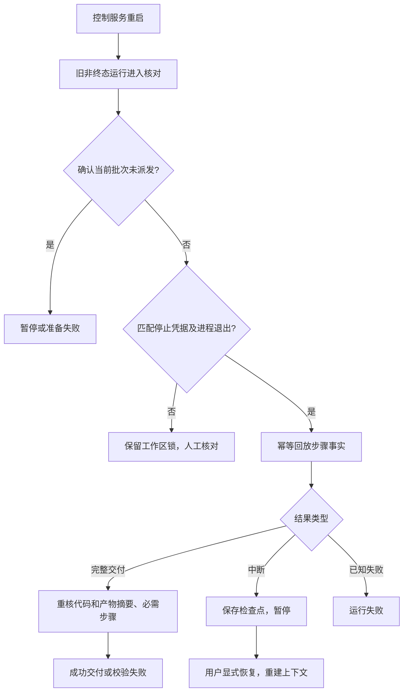

# 运行恢复与进程管理

更新：2026-11-09。本文件描述当前实现及其边界；总体产品要求见[设计稿](AI-Work-OS-设计稿-v1.0.md)，验收证据见[验证记录](验证记录.md)。

## 恢复规则

控制服务退出、Worker退出、委托命令退出分别是不同的事实。服务重启不会自动重跑写操作，也不会凭一个PID已消失就解除工作区锁。

| 可核实的事实 | 平台行为 |
|---|---|
| 当前协议已记录派发意图，但没有该批次的派发租约 | 依据“先存租约、后发任务”的顺序确认未派发；有可读检查点则暂停，否则失败，保留准备错误与现场 |
| Windows Worker留下匹配批次及输入摘要的停止凭据，已知进程均已退出 | 回放持久步骤；完整结果重新校验后交付，已知失败记录为失败，中断运行保存检查点并暂停 |
| 已确认停止，但原运行正在取消 | 完成取消，不把迟到结果转成成功交付 |
| 凭据缺失、结构错误、批次/输入不匹配、进程仍存活或无法核实 | 保持待核对或取消中，保留写锁，要求进一步检查 |
| 用户完成现场和外部影响核对，且后端检查通过 | 保存人工声明和依据，解除写锁；恢复时重新执行全部步骤，旧证据仅作历史保留 |

自动恢复到暂停仅表示进程与本机执行现场已经核实，不代表所有外部副作用已核对，也不会自动重新执行任务。任务业务验收继续独立进行。

## 派发和持久记录

控制服务唯一写SQLite；Worker通过IPC和独立凭据文件提交事实。生产入口在数据库短事务中登记控制服务所有者。同一数据目录已有存活或无法核实的控制进程时，拒绝启动第二个服务。PID复用会保守阻止接管，不会据此杀死未知进程。

每次派发生成新`epoch`：

1. 在事务中领取outbox，保存当前协议的`dispatch_intent`。
2. 建立或复用Worktree，保存固定预算、批次和工作区锁。
3. 创建Worker，登记`execution_lease`，包含Worker PID、输入摘要、输出目录及凭据路径。
4. 保存成功后才向Worker发送任务。Worker核对收到的输入摘要，在调用执行器前创建初始凭据。
5. 步骤与最终结果先写入凭据，再发送IPC；正常IPC仍及时更新数据库事件和尝试记录。

凭据位于运行目录的`receipts/<runId>/<epoch>.json`，与任务代码目录分离。更新先写临时文件、刷新文件、再重命名；解析限制体积并校验结构、运行ID、批次、Worker PID及输入摘要。这里的摘要用于关联和完整性检查，不构成对同一本机用户恶意篡改的签名认证。

数据库用`runId + epoch + attemptId + status`识别已接收的步骤事实。服务收到IPC后又读取到同一持久事实，不会重复增加尝试次数或重复生成事件；交付与终态变更在同一事务内完成。

若崩溃发生在Worktree已创建、数据库绑定尚未提交之间，运行会记录为未派发失败，磁盘现场保留。当前不会自动删除这些目录；产物和孤立工作区生命周期仍属后续工作。

## Windows执行进程

每条执行器/测试命令通过平台自带的PowerShell包装器启动：先挂起创建目标进程，将其加入Job Object，再恢复执行。包装器不设置允许子进程脱离此Job的标志。

Windows执行器从绝对PATH目录解析后调用，包装器使用系统PowerShell绝对路径；不隐式搜索任务目录中的同名程序。用户明确配置的相对测试路径按工作区解析，属于项目已授权的测试内容。选择显式查找规则的依据见[Microsoft SearchPathW说明](https://learn.microsoft.com/en-us/windows/win32/api/processenv/nf-processenv-searchpathw)。

命令正常结束、收到停止文件，或检测到Worker退出时，包装器终止Job中剩余进程，并查询活动进程数。只有活动进程归零才写停止证明。Job还配置了关闭最后句柄时终止成员的机制，作为包装器意外退出时的回收保障。实现依据[Microsoft Job Objects](https://learn.microsoft.com/en-us/windows/win32/procthread/job-objects)和[Job限制参数](https://learn.microsoft.com/en-us/windows/win32/api/winnt/ns-winnt-jobobject_basic_limit_information)。

Worker从控制服务的Windows默认父进程Job中分离启动，同时保留监督关系和IPC；否则控制服务强制退出可能先杀死Worker，使其来不及记录停止事实。该选择经真实控制进程崩溃测试验证，行为解释依据[libuv Windows进程实现](https://github.com/libuv/libuv/blob/v1.51.0/src/win/process.c)。窗口保持隐藏。

Worker收到暂停、取消或IPC断开时共用一次停止操作，等待包装器确认后才声明停止。正常关闭服务先申请暂停，等待Worker退出；超过30秒则记录待核对并保留锁，不把超时伪装成成功停止。

这些机制覆盖Job成员及其继承成员，不等同于网络隔离，也不能撤销已经发生的外部动作。独立工具服务器、系统服务、远程服务和代理进程是否仍有动作，需要相应执行器契约与动作台账核实。当前尚未完成完整外部动作台账，不据此宣称所有执行器和系统副作用均已安全回收。

POSIX仍使用进程组控制，不能证明主动脱离进程组的后代已停止，因此没有开放基于该凭据的崩溃自动解除锁。完整跨平台停止保证及服务型执行器恢复仍待补齐。

## 人工核对

执行台对待核对和取消中的Agent运行显示“执行状态核对”。

1. 点击“检查恢复条件”，读取当前批次、代码摘要、已知PID状态和停止凭据概况。
2. 检查遗留进程、代码变化及外部动作；缺少PID记录不能视为没有遗留进程。
3. 填写核对依据，并明确确认旧执行及遗留进程已停止、外部影响已处理。
4. 后端重新核对批次、代码摘要和已知进程。任何已知PID存活或不可核实，都拒绝解除锁；不会向该PID发送强制终止命令。
5. 核对通过后保存`reconciliation`和审计事件。取消中的运行转为已取消；其他运行暂停，全部步骤证据失效，需用户显式恢复后重新验证。

人工声明是用户提供的核对结论，事件明确标记`manual-attestation`，不会冒充机器证明。原步骤尝试与原产物保留，运行ID及冻结资源不被覆盖。

API：

| 接口 | 含义 |
|---|---|
| `GET /api/v1/runs/:id/recovery` | 查看当前核对条件，要求本机令牌 |
| `POST /api/v1/runs/:id/recovery` | 提交批次、代码摘要、两项明确声明和核对理由，重新校验后处理 |

## 验证范围

`tests/recovery.test.ts`使用临时Git仓库、真实控制进程、真实Worker及脚本执行器，覆盖后台子进程回收、控制服务硬崩溃、Worker硬崩溃、最终结果丢失、错误输入凭据、产物变更、派发前崩溃、人工核对门槛和单控制服务所有权。Windows专属测试在其他系统跳过，不能把跳过解释为已通过。

这些测试不调用模型，不证明真实Codex内部工具服务、OpenCode服务端或远程动作恢复已验证。真实执行器冒烟证据仍单独记录。
